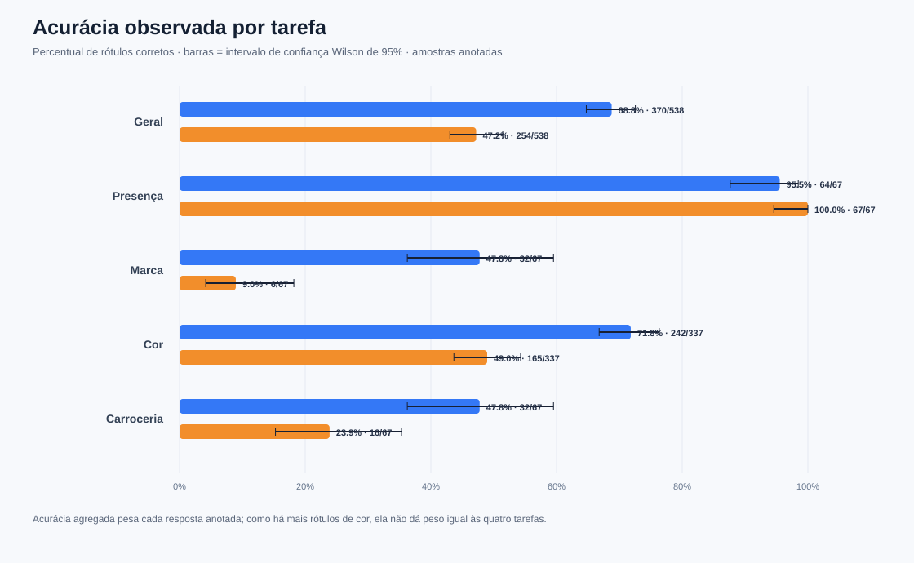
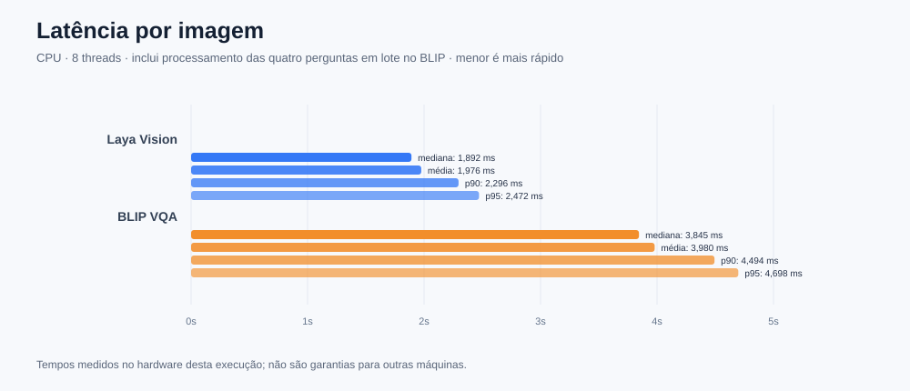
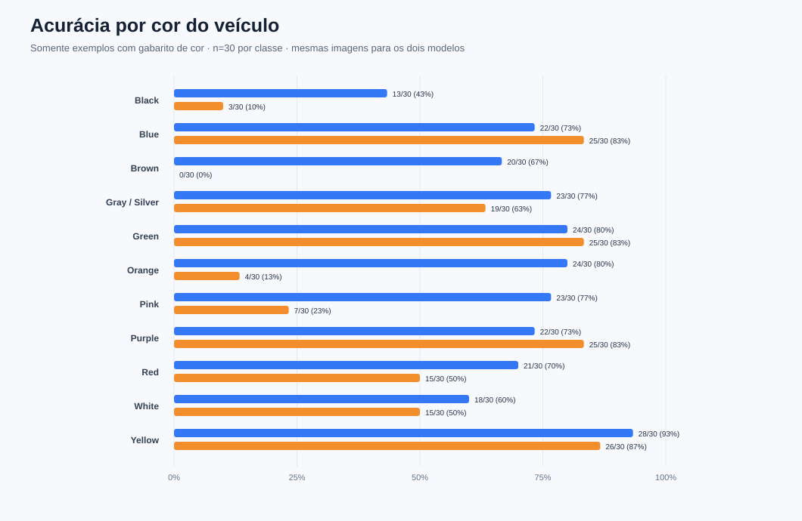
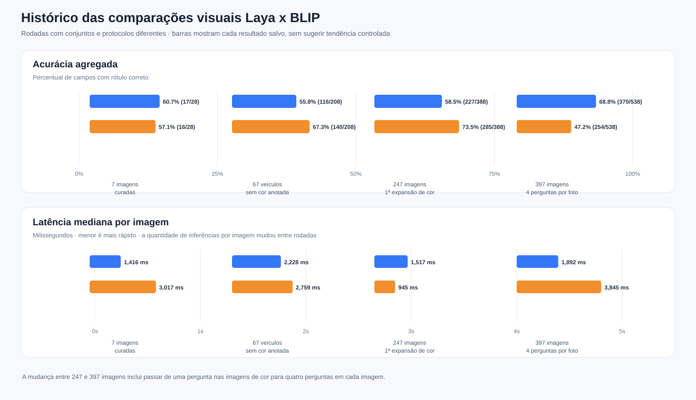

# System One Testing

Experimentos para avaliar modelos de decisão System 1 (Laya) em tarefas reais de classificação, roteamento e inspeção visual.

## Estrutura do projeto

```
SystemOneTesting/
├── web/
│   ├── index.html          # Interface visual em tempo real (Tailwind / responsiva)
│   └── server.py           # Servidor local para inspeção interativa de imagens
├── examples/
│   ├── laya_text.py        # Exemplos de uso da API textual (/v1/systemone)
│   └── laya_vision.py      # Exemplo com imagens (thaitea/laya-vision)
├── eval/
│   ├── harness.py          # Harness de avaliação em batch textual
│   ├── vision_cars.py      # Avaliação de imagens de carros (acurácia, latência)
│   ├── datasets/
│   │   └── default.jsonl   # Dataset anotado: 15 casos, 5 domínios
│   ├── images/cars/        # Imagens de teste (carros e paisagens)
│   └── results/            # Resultados JSON por execução (auto-gerado)
└── vendor/laya-vision/     # Código de inferência do modelo visual
```

## Laya textual no Ollama

O Laya textual está instalado no Ollama local. A API de decisões é `/v1/systemone`; ela aceita um `state` (texto ou JSON estruturado) e perguntas tipadas como `noul` (sim/não), `choice` (opções) e `score` (rubrica ordenada). A versão `laya` do Ollama é somente texto.

Confirme que o Ollama está ativo e que o modelo aparece na lista:

```bash
ollama --version
ollama list
```

O Laya exige Ollama 0.40.0 ou mais recente. Se ainda não estiver baixado:

```bash
ollama pull laya
```

Este modelo textual é independente do exemplo visual abaixo.

## Laya Vision com imagens

`thaitea/laya-vision` é uma variante independente e experimental que recebe a imagem diretamente e responde perguntas tipadas (`noul`, `choice`, `score`) com probabilidades. Não roda como o `laya` já instalado no Ollama: o model card orienta usar o pacote Python próprio, que baixa os pesos do Hugging Face. O exemplo abaixo pergunta diretamente à imagem se há um carro e sobre a marca e a cor, em uma chamada.

Crie um ambiente Python e instale o código de inferência publicado pelo autor:

```bash
python3 -m venv .venv
source .venv/bin/activate
git clone https://github.com/r33drichards/laya-vision vendor/laya-vision
python -m pip install -e ./vendor/laya-vision torchvision pillow
```

Execute com uma imagem local:

```bash
python examples/laya_vision.py ./imagem.jpg
```

O checkpoint tem cerca de 201 milhões de parâmetros e processa uma imagem por estado, redimensionada para um tile de 512 px. É pesquisa experimental; confira a licença CC BY-NC-SA 4.0 antes de usar fora de testes não comerciais. As probabilidades devem ser avaliadas com imagens anotadas do seu próprio domínio.

## Interface Web em Tempo Real (Browser)

Para visualizar e testar imagens interativamente com interface didática:

```bash
source .venv/bin/activate
python web/server.py --port 7860
```

Acesse no navegador: **[http://localhost:7860](http://localhost:7860)**

O playground executa **um modelo por sessão**. Para usar Laya Vision (rápido), inicie:

```bash
.venv/bin/python web/server.py --model laya --port 7860
```

Para usar o Clef-Flash hospedado no Cloudflare Workers AI, configure as credenciais no terminal e inicie outra sessão web:

```bash
export CLOUDFLARE_ACCOUNT_ID="seu_account_id"
export CLOUDFLARE_API_TOKEN="seu_api_token_com_permissao_workers_ai"
.venv/bin/python web/server.py --model clef --port 7860
```

Encerre uma sessão com `Ctrl+C` antes de iniciar a outra na mesma porta.

Para testar Clef-Flash localmente em Q4_K_M, rode o launcher em um terminal. Ele baixa os pesos quantizados e inicia `llama-server` na porta `11437`:

```bash
bash run_clef_local.sh
```

Em outro terminal, abra o playground usando essa instância local:

```bash
.venv/bin/python web/server.py --model clef-local --port 7860
```

## Teste isolado de cada modelo

Os scripts abaixo avaliam a mesma imagem de Audi TT e fazem as mesmas duas perguntas. Rode apenas um por vez:

```bash
.venv/bin/python test_laya_real_image.py
.venv/bin/python test_clef_local.py
.venv/bin/python test_clef_real_image.py
```

`test_clef_local.py` exige o servidor iniciado por `run_clef_local.sh`; `test_clef_real_image.py` usa a API hospedada da Cloudflare e exige `CLOUDFLARE_ACCOUNT_ID` e `CLOUDFLARE_API_TOKEN`. Os testes aceitam outra imagem como argumento posicional.

## Comparação local: Laya Vision x BLIP VQA

O benchmark usa um subconjunto diverso de 40 imagens do split de teste Stanford Cars, carros reais locais, controles sem carro e 330 carros com cor rotulada: 30 por classe para preto, branco, cinza/prata, vermelho, azul, marrom, verde, amarelo, laranja, rosa e roxo. As imagens coloridas vêm do dataset público de classificação de cor de veículos e são filtradas para carros com YOLO11n; os grupos esparsos são complementados por imagens de automóveis no Wikimedia Commons, com licença e origem anotadas no manifesto.

Os dois modelos recebem as mesmas quatro perguntas base (presença, marca, cor e carroceria) para cada imagem. Nas perguntas de múltipla escolha, ambos recebem a mesma lista nominal de opções, com 12 alternativas para marca, 13 para cor e 10 para carroceria; presença tem duas respostas. Só campos com rótulo de referência são pontuados. A interface, porém, não é equivalente: Laya recebe uma escolha tipada, enquanto o BLIP recebe um prompt textual com as alternativas e gera texto livre. A lista longa demonstrou reduzir a aderência do BLIP às instruções; portanto, os resultados medem o pipeline e o prompt usados nesta rodada, não uma comparação definitiva da capacidade máxima dos modelos.

Para recriar esse conjunto balanceado a partir da fonte, baixe e extraia o arquivo do Hugging Face, instale `unar` no sistema e `ultralytics` no ambiente virtual:

```bash
hf download WandererGuy/vehicle-color-classification-dataset --type dataset --include dataset.rar --local-dir /tmp/vehicle-colors
mkdir -p /tmp/vehicle-color-extract
sudo apt-get install unar
unar -q -o /tmp/vehicle-color-extract /tmp/vehicle-colors/dataset.rar
.venv/bin/python -m pip install ultralytics
.venv/bin/python eval/prepare_car_color_test_set.py --source-dir /tmp/vehicle-color-extract/dataset
```

O manifesto fica em `eval/datasets/car_color_test.json`; as imagens locais ficam em `eval/images/color_test/` e são ignoradas pelo Git. A preparação filtra carros do dataset original e, quando necessário, busca fotos licenciadas no Wikimedia Commons; a origem e a licença de cada complemento ficam anotadas no manifesto. [Dataset de cores no Hugging Face](https://huggingface.co/datasets/WandererGuy/vehicle-color-classification-dataset) · [Categorias de automóveis por cor no Wikimedia Commons](https://commons.wikimedia.org/wiki/Category:Orange_automobiles).

Se precisar recriar o ambiente local:

```bash
python3 -m venv .venv
.venv/bin/python -m pip install torch torchvision --index-url https://download.pytorch.org/whl/cpu
.venv/bin/python -m pip install transformers safetensors pillow
.venv/bin/python -m pip install -e ./vendor/laya-vision
```

```bash
.venv/bin/python eval/compare_laya_blip.py --threads 8
```

Baixe o subconjunto de imagens uma vez e inicie o dashboard para abrir o navegador e rodar a comparação automaticamente:

```bash
.venv/bin/python eval/download_stanford_cars_sample.py --count 40 --per-make 2
.venv/bin/python web/benchmark_server.py
```

O dashboard mostra a imagem atual, as respostas dos dois modelos, acertos, latência e progresso de cada etapa. Encerre com `Ctrl+C`. O primeiro uso baixa os pesos de `Salesforce/blip-vqa-base` (~1,5 GB). O manifesto das imagens fica em `eval/datasets/stanford_cars_sample.json`; as imagens baixadas ficam localmente em `eval/images/stanford_cars/` e são ignoradas pelo Git. Fonte: [Stanford Cars no Hugging Face](https://huggingface.co/datasets/naufalso/stanford_cars). Os resultados completos por imagem/modelo ficam em `eval/results/laya-blip-car-color.json`; a análise desta rodada fica em `eval/results/laya-blip-empirical-report.md`. Os resultados antigos de referência continuam em `eval/results/stanford-cars-laya-vs-blip.json`. Para testar o BLIP isoladamente numa imagem:

```bash
.venv/bin/python test_blip_vqa.py ./imagem.jpg --question "What color is the car?"
```

No Transformers 5, use a API direta do modelo; o pipeline genérico `visual-question-answering` foi descontinuado nessa versão. O comparador carrega um modelo por vez para caber melhor em máquinas sem GPU. A amostra pequena dá uma indicação para este domínio, não uma conclusão geral sobre os modelos.

### Resultados empíricos e gráficos estatísticos

A rodada atual avaliou 397 imagens e 538 campos com gabarito. A acurácia agregada foi 370/538 (68,77%) para Laya e 254/538 (47,21%) para BLIP. A mediana por imagem foi 1.892 ms para Laya e 3.845 ms para BLIP (aproximadamente 2,03x mais tempo para BLIP). Estes números são de CPU, 8 threads, e do prompt descrito no [relatório empírico](eval/results/laya-blip-empirical-report.md). O BLIP foi perfeito na detecção de presença, mas teve baixa aderência ao formato de alternativas em marca e carroceria; isso afeta a leitura da diferença de acurácia. A acurácia agregada pesa cada resposta anotada, então a tarefa de cor (337 de 538 campos) tem maior peso. O subconjunto balanceado de cor contém 330 fotos, 30 para cada uma de 11 classes.

O histórico também inclui comparações anteriores com 7, 67 e 247 imagens. Os dados e resultados de cada etapa estão em [`laya-blip-history.json`](eval/results/laya-blip-history.json), com o gráfico longitudinal em SVG abaixo. Essas rodadas mudaram o conjunto, o número de perguntas realmente executadas em imagens de cor e o prompt; não são uma sequência controlada de evolução do modelo. O relatório apresenta cada etapa e os experimentos anteriores apenas com Laya, incluindo os testes textuais, em uma seção separada.

Para recriar os três SVGs após uma nova avaliação:

```bash
.venv/bin/python eval/plot_laya_blip_results.py
```

**Acurácia geral e por pergunta**



**Latência por imagem**



**Acurácia nas 11 classes do conjunto balanceado (30 imagens por classe)**



**Histórico das quatro rodadas comparativas**



Os intervalos de confiança são descritivos, e as imagens não constituem amostra aleatória de todos os veículos. Veja no relatório a metodologia, limitações, análise de aderência do prompt e fatores técnicos de velocidade e acurácia.

## Experimentos

Registre, para cada caso, a entrada, as regras/opções, a resposta correta anotada, a resposta do modelo, as probabilidades, a latência e a versão do modelo. Separe os dados usados para ajustar limiares do conjunto final de avaliação. As probabilidades declaradas pelo modelo não garantem calibração no seu domínio.

## Comparação por conjunto completo de atributos (Teste 7)

O próximo estudo está definido no [plano de avaliação robusta](eval/plans/robust_visual_description_evaluation.md): dados separados para desenvolvimento, calibração e teste final; anotação independente; comparação pareada; e custo por descrição completa correta. A etapa confirmatória com anotação humana ainda não foi executada.

A etapa sem anotação humana tem um [piloto automatizado](eval/experiments/automated_pilot_20261026/report.md) separado: auditoria dos dados, parser estrito, desempenho em blocos alternados, configurações completas de prompt, degradações, controles sintéticos e fila. Essa etapa não substitui a avaliação confirmatória de qualidade. Há também uma [auditoria do orçamento de opções do Laya](eval/experiments/laya_option_budget_20261026/report.md).

Para reproduzir em um diretório novo, com os pesos já no cache:

```bash
.venv/bin/python -m unittest discover -s eval/tests -v
.venv/bin/python eval/run_automated_description_pilot.py --run-dir eval/experiments/novo_piloto --threads 8
.venv/bin/python eval/report_automated_description_pilot.py eval/experiments/novo_piloto
.venv/bin/python eval/audit_laya_option_budget.py --run-dir eval/experiments/novo_orcamento
.venv/bin/python eval/simulate_paired_test_power.py --run-dir eval/experiments/novo_poder
```

O runner grava progresso e permite `--resume` com o mesmo diretório e configuração. Energia e custo monetário só serão informados quando houver medição e parâmetros disponíveis.

Os resultados automatizados têm um [atlas com 13 figuras científicas](eval/figures/scientific_20261026_final/README.md), [PDF completo](eval/figures/scientific_20261026_final/relatorio_estatistico.pdf) e perfis individuais de [Laya](eval/figures/scientific_20261026_final/12_perfil_laya.pdf) e [BLIP](eval/figures/scientific_20261026_final/13_perfil_blip.pdf). Cada figura está disponível em PNG 300 dpi, SVG e PDF, com notas metodológicas, unidades, tamanho amostral e intervalos quando aplicáveis. Os CSVs e hashes permitem conferir os dados de origem. Para gerar outra versão sem sobrescrever arquivos:

```bash
.venv/bin/python eval/plot_scientific_description_results.py --output eval/figures/nova_execucao
```

O [Teste 7](eval/results/test_7_complete_tags_report.md) compara a entrega de quatro atributos por imagem: presença, marca, cor e carroceria para veículos; presença, capacete, objeto transportado e vestimenta superior para pessoas. O BLIP recebe perguntas curtas abertas em batch; o Laya recebe decisões tipadas com opções fixas. O critério principal exige todos os campos corretos na mesma imagem, incluindo abstenções quando o atributo não está visível. O tempo medido cobre o conjunto completo de perguntas.

A amostra contém 41 imagens locais com anotações revisadas visualmente pelo agente antes da inferência, incluindo controles negativos. Os rótulos e hashes estão no [manifesto](eval/datasets/test_7_complete_tags_manifest.json). Trata-se de uma amostra exploratória reutilizada, sem adjudicação humana independente; o teste não valida uma integração real com o CaptionerManager.

```bash
# Opcional: reconstruir o manifesto com as imagens já disponíveis localmente
.venv/bin/python eval/build_test_7_dataset.py
# Executar com pesos já presentes no cache
HF_HUB_OFFLINE=1 TRANSFORMERS_OFFLINE=1 .venv/bin/python eval/run_test_7_complete_benchmark.py --threads 8 --repetitions 3
.venv/bin/python eval/generate_test_7_report.py
```

Os [resultados brutos](eval/results/test_7_complete_tags_results.json) preservam respostas anteriores e posteriores ao filtro de ausência, probabilidades disponíveis, tempos, erros e versões. As três repetições medem estabilidade e latência; a acurácia usa a primeira execução por imagem.
