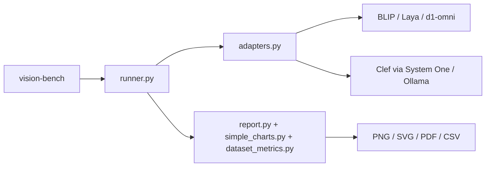

# Arquitetura (CLI, sem interface web)

| Componente | Responsabilidade |
|---|---|
| `vision_bench/cli.py` | Entrada única: doctor, run, report, pack-data, unpack-data, clef-server |
| `vision_bench/runner.py` | Execução serial e retomável com configuração e máquina congeladas |
| `vision_bench/report.py` | Relatório Markdown + metrics.csv/json + gráficos de comparação |
| `vision_bench/simple_charts.py` | Gráficos horizontais de acurácia e latência |
| `vision_bench/dataset_metrics.py` | Métricas, matrizes de confusão e gráficos por atributo |
| `vision_bench/adapters.py` | Integrações de modelos (BLIP, Laya, d1-omni, System One HTTP) |
| `vision_bench/core.py` | Contrato, parsing estrito e I/O verificada de datasets |
| `vision_bench/protocols.py` | Contrato por evento, descrição e diagnóstico de saída |
| `vision_bench/clef.py` | Download de pesos do Clef e servidor llama-server |
| `benchmarks/` | Configurações, contratos e dataset portátil |
| `eval/` | Experimentos e evidências científicas anteriores |
| `scripts/` | Instalação e download de modelos |
| `tests/` | Testes do motor (métricas de dataset) |

Nenhuma evidência em `eval/experiments`, `eval/results` ou `eval/figures` é movida ou recalculada ao desenvolver o projeto. Modelos novos entram em `benchmarks/configs/`.
