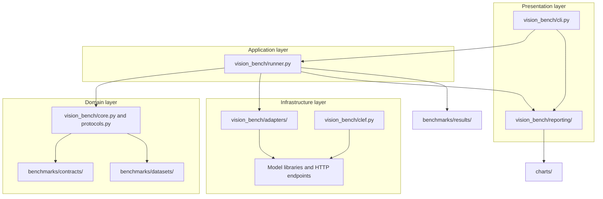

# Project architecture

The project is a local CLI application organized as a modular monolith with
traditional layers. Each module has a focused responsibility, and the CLI is the
only user-facing entry point.



## Layer responsibilities

| Layer | Modules and data | Responsibility |
|---|---|---|
| Presentation | `vision_bench/cli.py`, `vision_bench/reporting/` | Parse commands and present benchmark results as reports and charts. |
| Application | `vision_bench/runner.py` | Coordinate configuration, model adapters, dataset events, repetitions, and persisted runs. |
| Domain | `vision_bench/core.py`, `vision_bench/protocols.py`, `benchmarks/contracts/` | Define validation, normalization, request/prompt semantics, and response rules. |
| Infrastructure | `vision_bench/adapters/`, `vision_bench/clef.py` | Communicate with local model libraries, HTTP services, and the Clef server process. |

Dependencies flow from presentation and application toward domain rules. Domain
modules do not import the CLI or model adapters. `runner.py` is the coordination
point between domain behavior and infrastructure. `core.py` currently also
contains verified dataset file operations; if that responsibility grows, move it
to a focused storage module in the infrastructure layer.

## Important paths

| Path | Responsibility |
|---|---|
| `vision_bench/cli.py` | Entry point for doctor, run, report, dataset packing, and Clef server commands. |
| `vision_bench/runner.py` | Serial, resumable benchmark execution with frozen configuration and machine metadata. |
| `vision_bench/core.py` | Dataset validation, text normalization, result finalization, and verified dataset I/O. |
| `vision_bench/protocols.py` | Build model questions/prompts and diagnose response output. |
| `vision_bench/adapters/base.py` | Shared adapter interface and deterministic mock adapter. |
| `vision_bench/adapters/http.py` | System One HTTP request implementation and endpoint validation. |
| `vision_bench/adapters/transformers.py` | Shared Torch adapter and BLIP requests. |
| `vision_bench/adapters/laya.py` | Laya native requests and its Transformers compatibility patch. |
| `vision_bench/adapters/d1_omni.py` | d1-omni native requests. |
| `vision_bench/adapters/__init__.py` | Built-in adapter registry and public factory. |
| `vision_bench/clef.py` | Clef model download, server setup, and process metadata. |
| `vision_bench/reporting/` | Metrics, Markdown reports, and chart generation. |
| `benchmarks/configs/` | Adapter, model revision, endpoint, and runtime configuration. |
| `benchmarks/contracts/` | Request fields, prompt definitions, answer choices, and validation criteria. |
| `benchmarks/datasets/` | Portable and historical datasets grouped by domain. |
| `benchmarks/tasks/` | Historical benchmark runners, preparation tools, and report generators. |
| `benchmarks/results/` | Historical result data and reports. |
| `charts/` | Historical figures organized by chart characteristic. |
| `charts/runs/` | Provenance, tables, and supporting files for chart runs. |
| `models/` | Per-model experiments and the shared legacy model-test framework. |
| `models/laya/laya_vision/` | External Git submodule; its contents are maintained upstream. |
| `scripts/` | Installation, model download, dataset preparation, and report commands. |
| `tests/` | Tests for the benchmark engine and migrated tasks. |

## Dataset layout

Portable datasets are separated from historical task datasets:

```text
benchmarks/datasets/
├── vehicles/
│   └── portable.json
└── historical/
    ├── vehicles/
    ├── people/
    ├── robustness/
    ├── multi_object/
    ├── prompts/
    └── mixed/
```

## Historical chart categories

```text
charts/
├── accuracy/
├── sampling/
├── classes/
├── synthetic_controls/
├── performance/
├── runs/
├── queue/
├── history/
├── latency/
├── memory/
├── multiple_objects/
├── budget/
├── model_profiles/
├── prompts/
├── reports/
├── repeatability/
├── robustness/
└── vehicles/
```

New model request logic belongs in the matching module under
`vision_bench/adapters/`. Request and prompt definitions belong in
`benchmarks/contracts/`. Reusable chart code belongs in the matching module
under `vision_bench/reporting/charts/`; historical output files belong under
`charts/<category>/`.
