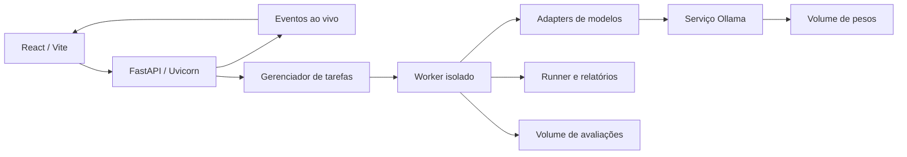

# Arquitetura da aplicação

| Componente | Responsabilidade |
|---|---|
| `frontend/src/App.jsx` e `components/` | Navegação, componentes de cada tela e acompanhamento via eventos |
| `frontend/src/api.js` | Cliente HTTP e exportação JSON |
| `frontend/vite.config.js` | Build e proxy de desenvolvimento |
| `vision_bench/webui/api.py` | Aplicação ASGI, REST, eventos, lifecycle e frontend compilado |
| `vision_bench/webui/services.py` | Catálogo, validação dos pedidos, diagnóstico e artefatos |
| `vision_bench/webui/jobs.py` | Uma tarefa ativa, processos, estados e cancelamento |
| `vision_bench/webui/worker.py` | Inferência, benchmark e download do modelo via API Ollama |
| `vision_bench/adapters.py` | Integrações compartilhadas de modelos |
| `vision_bench/runner.py` | Avaliação reproduzível e proveniência |
| `vision_bench/report.py` | Métricas e gráficos |
| `Dockerfile` | Build Node + runtime Python, sem entrypoint shell |
| `compose.yaml` | Aplicação, Ollama, healthchecks e volumes |
| `compose.gpu.yaml` | Acesso opcional à GPU NVIDIA |
| `tests/` | API ASGI, integração e navegador |
| `eval/` | Experimentos e evidências científicas anteriores |

O processo web não carrega pesos nem roda inferência durante a inicialização. Trabalhos são executados em subprocesso; a API transmite os estados por Server-Sent Events. O banco de tarefas é o conjunto de documentos JSON atômicos no volume persistente. Não é necessário Redis/Postgres para uma instalação local com uma tarefa por vez.

A aplicação deve usar **um worker Uvicorn**. Escalar o servidor para vários processos exigiria substituir o gerenciador por uma fila e coordenação persistente entre processos; aumentar `--workers` isoladamente não implementa isso.

As interfaces antigas em `web/` e `vision_bench/webui/static/` são mantidas apenas para referência e testes de compatibilidade. O frontend ativo está em `frontend/`. Os iniciadores `iniciar_clef_ollama.sh`, `.bat` e o script Python associado foram removidos; Docker Compose é o ponto de entrada operacional.

Modelos novos entram em `benchmarks/configs/`. Novos contratos/datasets precisam ser registrados nos serviços. Nenhuma evidência em `eval/experiments`, `eval/results` ou `eval/figures` é movida ou recalculada ao desenvolver a aplicação.
