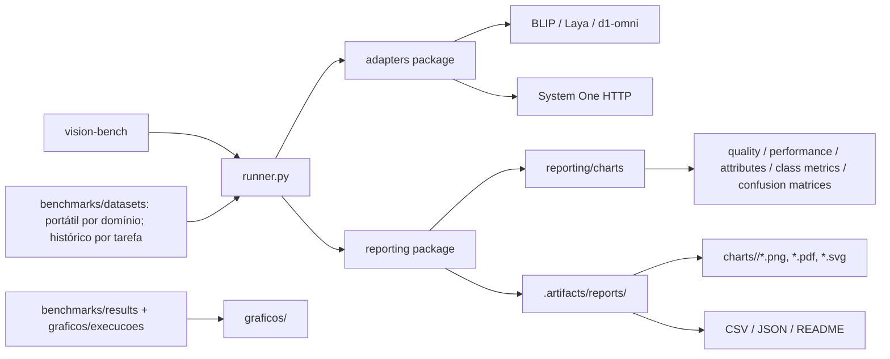

# Arquitetura (CLI, sem interface web)



| Componente | Responsabilidade |
|---|---|
| `vision_bench/cli.py` | Entrada única: doctor, run, report, pack-data, unpack-data, clef-server |
| `vision_bench/runner.py` | Execução serial e retomável com configuração e máquina congeladas |
| `vision_bench/reporting/report.py` | Relatório Markdown e tabelas de desempenho |
| `vision_bench/reporting/dataset_metrics.py` | Métricas por modelo, atributo e classe |
| `vision_bench/reporting/charts/` | Geração de gráficos agrupada por tipo |
| `vision_bench/reporting/charts/quality.py` | Acurácia e qualidade por atributo/classe |
| `vision_bench/reporting/charts/comparison.py` | Distribuição de latência e CPU |
| `vision_bench/reporting/charts/summary.py` | Gráficos horizontais de resumo |
| `vision_bench/reporting/charts/style.py` | Cores e rótulos compartilhados pelos gráficos |
| `vision_bench/adapters/` | Implementações de request separadas por backend e transporte |
| `vision_bench/adapters/base.py` | Interface comum e adapter simulado |
| `vision_bench/adapters/http.py` | Requests HTTP para System One e resolução de endpoint |
| `vision_bench/adapters/transformers.py` | Base local Torch e integração BLIP |
| `vision_bench/adapters/laya.py` | Requests nativos do Laya Vision e ajuste de compatibilidade |
| `vision_bench/adapters/d1_omni.py` | Requests nativos do d1-omni |
| `vision_bench/adapters/__init__.py` | Registro/fábrica pública dos adapters |
| `vision_bench/core.py` | Contrato, parsing estrito e I/O verificada de datasets |
| `vision_bench/protocols.py` | Contrato por evento, descrição e diagnóstico de saída |
| `vision_bench/clef.py` | Download de pesos do Clef e servidor llama-server |
| `benchmarks/configs/` | Seleção de adapter, modelo, revisão e endpoint |
| `benchmarks/contracts/` | Campos, tipos, prompts e critérios de resposta |
| `benchmarks/datasets/` | Manifests portáteis e históricos agrupados por domínio/tipo |
| `modelos/laya/laya_vision/` | Submódulo externo do código do Laya Vision |
| `graficos/` | Gráficos históricos separados por característica |
| `benchmarks/tasks/` | Execução, preparação e relatórios dos benchmarks históricos |
| `benchmarks/results/` | Resultados JSON, relatórios e evidências por benchmark/execução |
| `graficos/execucoes/` | Tabelas, proveniência e artefatos de cada execução de gráficos |
| `docs/plans/` | Planos metodológicos e de avaliação |
| `scripts/` | Instalação e download de modelos |
| `scripts/datasets/` | Download e preparação de datasets |
| `tests/` | Testes do motor (métricas de dataset) |

Relatórios, métricas e estilos têm um caminho de importação autoritativo em `vision_bench.reporting` e `vision_bench.reporting.charts`. Cada relatório grava os gráficos em `charts/quality/`, `charts/performance/`, `charts/attributes/`, `charts/class_metrics/` ou `charts/confusion_matrices/`, separados das tabelas e do README.

Datasets portáteis e históricos ficam separados por uso e assunto:

```text
benchmarks/datasets/
├── vehicles/
│   └── portable.json
└── historical/
    ├── vehicles/
    ├── people/
    ├── robustness/
    ├── multi_object/
    ├── prompts/
    └── mixed/
```

Os gráficos históricos ficam centralizados por característica:

```text
graficos/
├── desempenho/
├── latencia/
├── acuracia/
├── classes/
├── robustez/
├── prompts/
├── repetibilidade/
├── controles_sinteticos/
├── orcamento/
├── amostragem/
├── memoria/
├── fila/
├── perfis_modelos/
├── historico/
├── multiplos_objetos/
├── veiculos/
└── relatorios/
```

Os gráficos históricos ficam em `graficos/<caracteristica>/`; tabelas e proveniência de execuções ficam em `graficos/execucoes/`. Os dados de benchmark ficam em `benchmarks/datasets/`, e relatórios e resultados em `benchmarks/results/`. Código reutilizável do runner fica em `vision_bench/`; fluxos históricos ficam em `benchmarks/tasks/`. Modelos novos entram em `benchmarks/configs/`.
