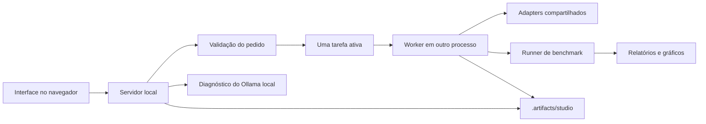

# Mapa do projeto

## Responsabilidades

| Diretório | Responsabilidade |
|---|---|
| `vision_bench/core.py` | Contrato, parser, validação e empacotamento de dados |
| `vision_bench/adapters.py` | Integração lazy com modelos Python, HTTP e simulação |
| `vision_bench/runner.py` | Execução reproduzível, aquecimento, recursos e proveniência |
| `vision_bench/report.py` | Estatísticas, tabelas e gráficos por execução/máquina |
| `vision_bench/cli.py` | Comandos públicos, incluindo `studio` |
| `vision_bench/webui/server.py` | HTTP local, catálogo, validação de pedidos e diagnóstico |
| `vision_bench/webui/jobs.py` | Exclusão mútua, processos, registros e cancelamento |
| `vision_bench/webui/worker.py` | Inferência isolada e chamada do benchmark/relatório |
| `vision_bench/webui/static/` | Interface em português, CSS e JavaScript separados |
| `benchmarks/` | Configuração declarativa e dados portáteis |
| `scripts/` | Preparação do ambiente e inicialização do Ollama/painel |
| `tests/` | Integração e navegador da aplicação atual |
| `eval/` | Pesquisa histórica; scripts e evidências preservados |
| `web/` | Interfaces anteriores; não é o ponto de entrada atual |
| `docs/` | Documentação atual e guia anterior |
| `examples/` | Exemplos manuais de modelos |

Os `test_*.py` da raiz são experimentos manuais anteriores, não a suíte de integração. Não foram movidos nesta reorganização para evitar quebrar comandos e referências antigas. As novas implementações entram no pacote `vision_bench`, e os novos testes da aplicação em `tests/`.

## Fluxo do painel

Abrir a página não importa torch/transformers nem inicia inferência. O processo de trabalho carrega apenas os adapters selecionados. O worker usa o parser e o contrato do motor, evitando outra implementação de normalização na interface.

O painel usa polling de estado para atualizar resultados a cada modelo e o progresso a cada evento do benchmark. Não há streaming de tokens: os modelos System One retornam decisões estruturadas.

## Extensão

- Novo modelo: acrescente um ID em um JSON de `benchmarks/configs/`, utilizando um adapter existente ou o protocolo `python:module:Class`. O catálogo do painel lê as configurações válidas.
- Novo domínio/perguntas: crie contrato versionado e registre em `Studio.contracts`; mudanças de taxonomia são outra tarefa experimental.
- Novo dataset no painel: manifeste imagens e hashes, depois cadastre em `Studio.manifests`. No CLI, use `--manifest` e `--data-root`.
- Nova tela: assets ficam em `webui/static/`; operações de inferência continuam no worker.

## Evidências

Esta reorganização não move nem recalcula os resultados em `eval/experiments`, `eval/results` e `eval/figures`. Preserva a proveniência das rodadas anteriores. Novas rodadas têm pastas próprias em `.artifacts`, com os arquivos congelados do runner.
