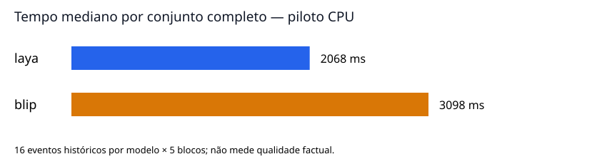

# Piloto automatizado — descrições visuais

Execução concluída: **452 eventos processados**, com respostas completas por domínio. Os eventos são reutilizações e variações de imagens históricas; não são 452 cenas independentes.

**Escopo:** desempenho, estabilidade, formato, truncamento de entrada, sensibilidade a perturbações e fila. A qualidade semântica baseada nos gabaritos antigos permanece exploratória; não houve anotação humana nova.

**Limitação da comparação de custo:** as medições principais do Laya usam o orçamento padrão, que trunca a pergunta de marca. Portanto, menor tempo não demonstra menor custo para receber as mesmas instruções completas. A auditoria adicional com 512 tokens removeu o truncamento no lote de seis imagens, mas precisa de validação de qualidade e medição maior antes de substituir essa configuração.

## Integridade e amostra

- 41 entradas históricas auditadas; 39 imagens únicas por hash.
- 2 grupos de duplicatas exatas entre tarefas: [['vehicle_no_car_landscape.jpg', 'person_060'], ['vehicle_no_car_field.jpg', 'person_059']].
- 0 arquivos ausentes encontrados nos manifestos históricos com caminho explícito.
- Divisão entre desenvolvimento e teste final não foi criada a partir dessas imagens. Todo este piloto pertence à exploração; futuras cenas confirmatórias permanecem por coletar.
- Máquina: 12th Gen Intel(R) Core(TM) i5-12450H; 8 núcleos físicos, 12 lógicos, 7.5 GiB de RAM; PyTorch com 8 threads.
- Pesos carregados offline e fixados por commit; configurações e hashes de código congelados antes das inferências. Nenhum resultado dos testes anteriores foi sobrescrito.

## Tempo e recursos — cinco blocos alternando ordem dos modelos

| Domínio | Modelo | Requisições | p50 / p90 / p95 (ms) | CPU média (s/evento) | RSS máximo ao fim da requisição (MiB) |
|---|---|---:|---:|---:|---:|
| vehicle | laya | 40 | 2252.0 / 2544.7 / 2736.4 | 18.04 | 1583 |
| vehicle | blip | 40 | 3086.0 / 3558.8 / 3736.0 | 24.22 | 2838 |
| person | laya | 40 | 1628.4 / 1897.3 / 2083.0 | 13.00 | 1583 |
| person | blip | 40 | 3111.6 / 3680.4 / 3824.4 | 24.59 | 2838 |
| all | laya | 80 | 2067.8 / 2332.9 / 2534.7 | 15.52 | 1583 |
| all | blip | 80 | 3098.3 / 3609.1 / 3823.7 | 24.41 | 2838 |

Razão de medianas BLIP/Laya: **1.50×**, intervalo pareado de 95% [1.39, 1.63]. Reamostragem estratificada de imagens e blocos, mantendo os pares; não é uma estimativa universal de hardware ou tráfego.

Pico de RSS do processo amostrado a cada 100 ms durante toda a execução: **3255 MiB**. A coluna por modelo mede RSS nos finais das requisições; inclui Python e memória retida pelo alocador, não é memória exclusiva dos pesos nem pico interno de cada inferência.

O tempo inclui abertura da imagem, processamento, todos os campos, normalização, filtro e renderização. Carga, warm-up e escrita do JSON ficam fora. A máquina manteve seus demais processos ativos; o ambiente inicial registra os maiores consumidores. p99 não é usado para uma conclusão de cauda com esta amostra.

| Modelo | Tempo projetado por 1.000 eventos | CPU projetada por 1.000 eventos |
|---|---:|---:|
| laya | 33.1 min | 258.6 CPU-min |
| blip | 53.1 min | 406.8 CPU-min |

Projeções usam a média observada para esta mistura de imagens. Tempo de CPU soma trabalho de múltiplas threads e pode exceder o tempo de parede. Energia e custo em reais: **não medidos**, pois não há sensor acessível nem tarifa/hardware amortizado definidos.

Carga observada com cache do sistema não controlado (não é carga fria): laya: 2.17 s de mediana em 6 carregamentos; blip: 0.36 s de mediana em 6 carregamentos. Warm-up é registrado à parte e excluído das latências.

## Estabilidade de saídas

| Modelo | Imagens avaliadas | Mesma saída nas cinco repetições | Erros de execução |
|---|---:|---:|---:|
| laya | 16 | 16/16 (100.0%) | 0 |
| blip | 16 | 16/16 (100.0%) | 0 |

Estabilidade determinística não comprova correção.

## Seis configurações completas por modelo

Doze imagens por configuração, incluindo positivos e controles. Não selecionar vencedor de qualidade com este gabarito exploratório. As linhas abaixo mostram custo/formato; a taxa de acerto nominal fica no JSON de métricas e não é confirmatória.

| Modelo | Configuração | Eventos com esquema válido | p50 (ms) | Perguntas médias executadas | Eventos com entrada truncada |
|---|---|---:|---:|---:|---:|
| laya | descriptive_joint | 12/12 (100.0%) | 2023.9 | 4.00 | 6/12 |
| laya | descriptive_gated | 12/12 (100.0%) | 2913.9 | 3.00 | 4/12 |
| laya | short_joint | 12/12 (100.0%) | 2350.2 | 4.00 | 6/12 |
| laya | short_gated | 12/12 (100.0%) | 3050.3 | 3.00 | 4/12 |
| laya | visible_joint | 12/12 (100.0%) | 2047.7 | 4.00 | 6/12 |
| laya | visible_gated | 12/12 (100.0%) | 3089.0 | 3.00 | 4/12 |
| blip | direct_joint | 9/12 (75.0%) | 3416.0 | 4.00 | 0/12 |
| blip | direct_gated | 9/12 (75.0%) | 3340.8 | 3.00 | 0/12 |
| blip | specific_joint | 11/12 (91.7%) | 3401.3 | 4.00 | 0/12 |
| blip | specific_gated | 11/12 (91.7%) | 3316.4 | 3.00 | 0/12 |
| blip | uncertain_joint | 8/12 (66.7%) | 3530.3 | 4.00 | 0/12 |
| blip | uncertain_gated | 8/12 (66.7%) | 3339.1 | 3.00 | 0/12 |

`joint` executa todos os campos juntos. `gated` testa presença antes dos atributos; uma ausência prevista evita executar os outros campos. Se a presença é falsa, o evento positivo inteiro falha. O ganho depende da prevalência real de negativos, não da proporção artificial deste lote.

### Truncamento no Laya

Campos com avisos de truncamento (inclui repetições): `{'make': 107}`. Instrução cortada: `{'make': 107}`.

Os resultados brutos preservam quais opções e instruções foram cortadas. Quando a pergunta de marca é truncada, a comparação não representa a instrução integral pretendida. Isso limita a interpretação de acurácia anterior e exige uma configuração que caiba no orçamento antes de um estudo confirmatório. Não foram removidas marcas conforme o gabarito.

## Sensibilidade a degradações

Comparação de cada variante com a inferência original da mesma imagem e configuração-base. Uma mudança pode ser erro ou correção; sem nova revisão de visibilidade, não chamamos isso de queda de acurácia.

| Modelo | Transformação | Conjuntos alterados | Campos alterados | Eventos com esquema válido |
|---|---|---:|---:|---:|
| laya | resize64 | 6/12 (50.0%) | 9/48 | 12/12 |
| laya | jpeg20 | 2/12 (16.7%) | 2/48 | 12/12 |
| laya | dark50 | 5/12 (41.7%) | 5/48 | 12/12 |
| laya | blur2 | 5/12 (41.7%) | 6/48 | 12/12 |
| blip | resize64 | 5/12 (41.7%) | 6/48 | 8/12 |
| blip | jpeg20 | 4/12 (33.3%) | 5/48 | 9/12 |
| blip | dark50 | 1/12 (8.3%) | 1/48 | 10/12 |
| blip | blur2 | 3/12 (25.0%) | 3/48 | 9/12 |

Transformações: redução a 64×64 e retorno ao tamanho original; JPEG qualidade 20; brilho em 50%; blur gaussiano de raio 2. Nenhuma variante conta como cena independente.

## Controles sintéticos sem objetos

| Modelo | Casos | Presença positiva indevida | Sem presença válida (parse/error) |
|---|---:|---:|---:|
| laya | 8 | 4/8 | 0/8 |
| blip | 8 | 0/8 | 0/8 |

Fundos uniformes preto/cinza/branco e ruído pseudoaleatório conhecido, consultados para ambos os domínios. Esses controles têm origem programática; não representam a diversidade de negativos reais. Desempenho neles não demonstra uma taxa operacional de falsos positivos.

## Fila com 1, 2 e 4 clientes

**Um único worker de inferência serializado**, compartilhado por até quatro threads chamadoras. Este ensaio mede espera/fila e valida integridade sob chamadas concorrentes; não mede inferência paralela nem escalabilidade de múltiplos workers.

| Modelo | Clientes | Requisições | Throughput (eventos/s) | p50 resposta incluindo fila (ms) | Espera média (ms) |
|---|---:|---:|---:|---:|---:|
| laya | 1 | 6 | 0.450 | 2269.2 | 0.0 |
| laya | 2 | 6 | 0.509 | 3596.6 | 1688.5 |
| laya | 4 | 6 | 0.509 | 7032.4 | 4204.0 |
| blip | 1 | 6 | 0.298 | 3171.5 | 0.0 |
| blip | 2 | 6 | 0.301 | 6533.1 | 2821.9 |
| blip | 4 | 6 | 0.322 | 10810.8 | 6196.8 |

Cada nível tem apenas seis requisições. Trata-se de smoke test da fila; capacidade sustentada e SLA requerem um teste de carga maior. A espera não deve ser confundida com tempo interno do modelo.

## Parser e renderização

O parser estrito foi congelado antes das novas inferências. Reprocessando as saídas históricas do BLIP, 12 campos mudam de interpretação; detalhes no JSON. Resposta não interpretável permanece `parse_error`, em vez de ser aceita silenciosamente como uma abstenção válida.

- Erros de execução: 0/452.
- Violações mecânicas do renderizador: 0. Isso comprova consistência com os atributos previstos, não verdade dos atributos na imagem.
- Imagens com saída diferente entre níveis da fila: 0.

- Respostas tipadas do Laya verificadas: 868; violações de chaves, faixa, soma ou escolha de maior probabilidade: 0. Tolerância da soma respeita arredondamento a quatro casas. Validade numérica não comprova calibração.

## O que fica pendente

- Anotação humana independente, seleção confirmatória de prompts e avaliação das descrições factualmente corretas.
- Dados novos e reservados, quotas de classe/condição e teste de transferência de domínio.
- Calibração de confiança e custo por descrição correta, pois dependem de gabarito confiável e política de aceitação.
- Energia/custo monetário, detector/recorte real e integração com CaptionerManager.
- Teste de carga sustentada e inferência realmente paralela com controle de memória e número de threads.

## Artefatos

- [Configuração congelada](frozen_config.json)
- [Auditoria](audit.json)
- [Ambiente](environment.json)
- [Predições brutas](predictions.jsonl)
- [Recursos amostrados](resource_samples.jsonl)
- [Métricas](metrics.json)
- [Orçamento de opções do Laya](../laya_option_budget_20261026/report.md)

- [Simulação de poder e tamanho da amostra](../paired_power_20261026/report.md)

