# Atlas estatístico — Laya Vision e BLIP VQA

**13 figuras**, com exportações PNG (300 dpi), SVG e PDF vetorial. [PDF completo](relatorio_estatistico.pdf).

Amostra exploratória. Não há nova anotação humana ou avaliação confirmatória da verdade das descrições. A configuração padrão do Laya trunca a pergunta de marca; os gráficos de custo precisam ser lidos com essa limitação.

## Convenções científicas

- Desempenho: 16 imagens distintas, oito por domínio, com cinco repetições; cada ponto de distribuição é a mediana por imagem. As 80 requisições por modelo não são 80 cenas independentes.
- Comparação de latência: bootstrap pareado por imagem e bloco, estratificado por domínio, 4.000 reamostragens; seed fixa. A figura 02 usa seu próprio cálculo, registrado na proveniência.
- Prompts: bootstrap estratificado por domínio para a mediana; Wilson 95% para proporções de esquema válido, com 12 imagens por configuração. Os limites são exploratórios e condicionais ao modelo de amostragem; a coleta de conveniência limita generalização.
- Robustez: mudança de respostas em relação ao original, não queda de acurácia. Wilson 95% exploratório por transformação; atributos e variantes da mesma imagem não são amostras independentes.
- Não há ajuste para múltiplos prompts ou degradações. Não interpretar uma pequena diferença entre barras como significância ou superioridade de qualidade.
- Controles sintéticos e auditoria de tokens: contagens determinísticas, sem fabricar intervalos populacionais. Fila: um lote por condição; não estimar IC de throughput a partir de seis clientes dependentes.
- Custo: tempo de parede, CPU-s e memória do processo. Não há medição de energia nem custo em reais; não converter uma redução temporal em economia elétrica.
- Cores acessíveis, escalas iguais entre modelos, unidades explícitas, eixos iniciados em zero quando representam magnitudes; razões usam referência de igualdade em 1.

## Figuras

### Desempenho por domínio

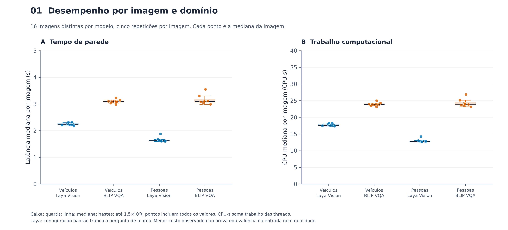

Pontos: medianas de cinco repetições; oito imagens por domínio e modelo; caixas descritivas.

[SVG](01_desempenho_distribuicoes.svg) · [PDF](01_desempenho_distribuicoes.pdf) · [PNG 300 dpi](01_desempenho_distribuicoes.png)

### Comparação pareada e intervalos

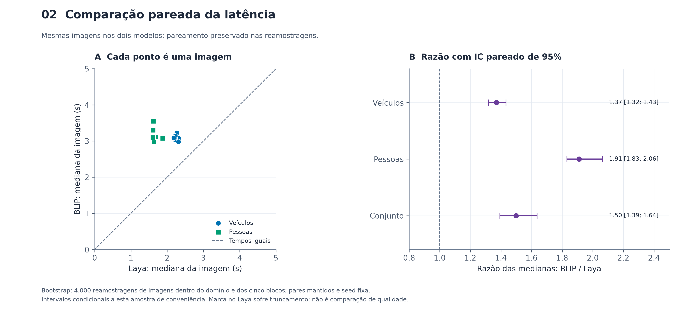

Bootstrap estratificado por domínio e pareado por imagem e bloco, 4.000 reamostragens.

[SVG](02_latencia_pareada.svg) · [PDF](02_latencia_pareada.pdf) · [PNG 300 dpi](02_latencia_pareada.png)

### Repetibilidade temporal e de saídas

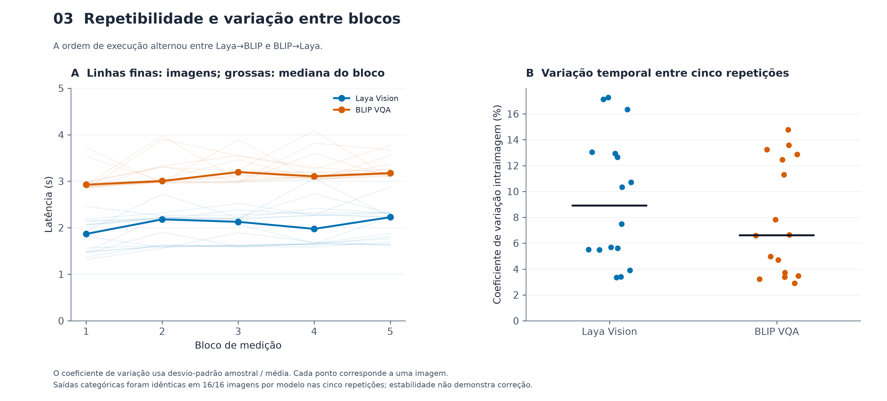

Cinco blocos descritivos; CV por imagem; sem pseudo-replicação do tamanho da amostra.

[SVG](03_repetibilidade.svg) · [PDF](03_repetibilidade.pdf) · [PNG 300 dpi](03_repetibilidade.png)

### Prompts — Laya Vision

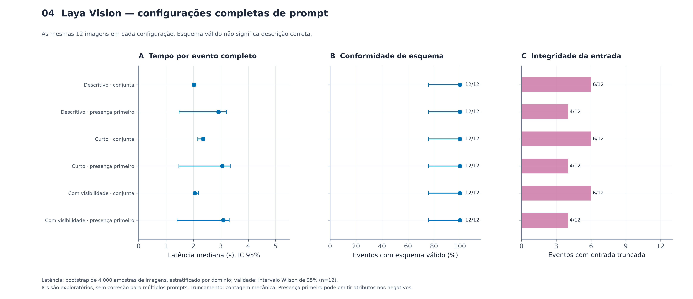

Conjuntos completos; bootstrap por imagem para latência e Wilson para validade; n=12 imagens por configuração.

[SVG](04_prompts_laya.svg) · [PDF](04_prompts_laya.pdf) · [PNG 300 dpi](04_prompts_laya.png)

### Prompts — BLIP VQA

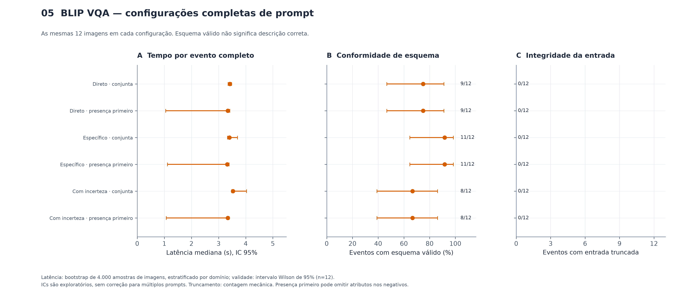

Conjuntos completos; bootstrap por imagem para latência e Wilson para validade; n=12 imagens por configuração.

[SVG](05_prompts_blip.svg) · [PDF](05_prompts_blip.pdf) · [PNG 300 dpi](05_prompts_blip.png)

### Sensibilidade a degradações

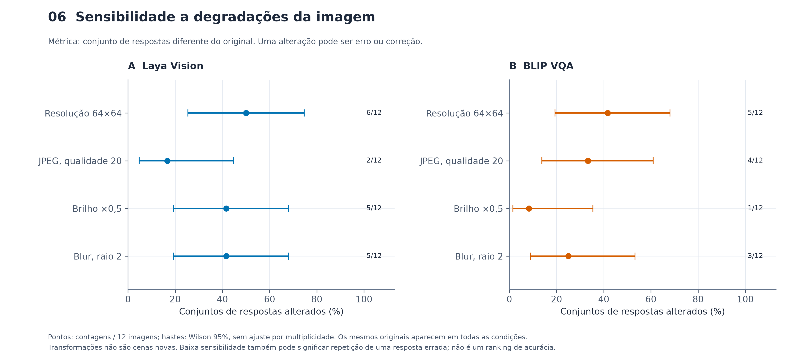

Mudança pareada em relação ao original; Wilson exploratório por transformação; não mede perda de acurácia.

[SVG](06_robustez.svg) · [PDF](06_robustez.pdf) · [PNG 300 dpi](06_robustez.png)

### Controles sintéticos sem objetos

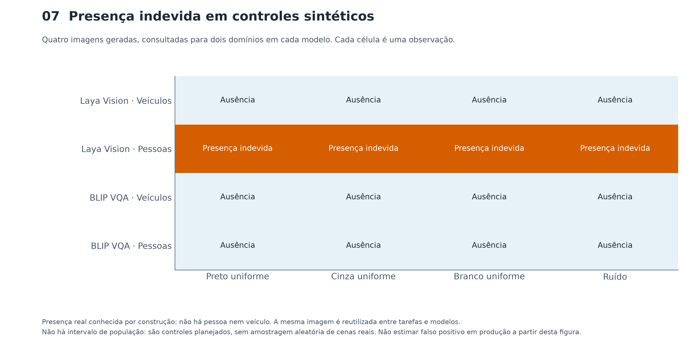

Matriz de observações exatas; nenhuma inferência populacional sobre quatro controles programáticos.

[SVG](07_controles_sinteticos.svg) · [PDF](07_controles_sinteticos.pdf) · [PNG 300 dpi](07_controles_sinteticos.png)

### Orçamento de tokens e efeito na latência

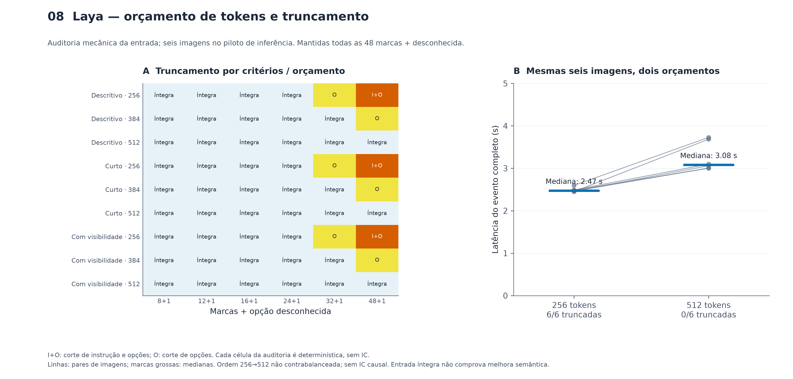

54 construções de entrada; 12 inferências em seis imagens; comparação pareada descritiva sem adjudicação de qualidade.

[SVG](08_orcamento_laya.svg) · [PDF](08_orcamento_laya.pdf) · [PNG 300 dpi](08_orcamento_laya.png)

### Fila e throughput

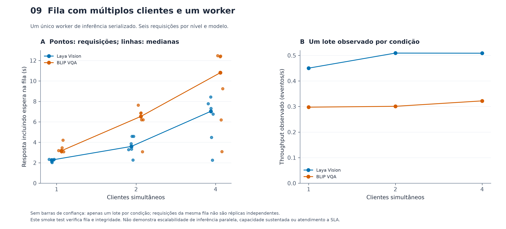

Seis requisições e um lote por nível; análise descritiva sem IC de throughput.

[SVG](09_fila.svg) · [PDF](09_fila.pdf) · [PNG 300 dpi](09_fila.png)

### Poder e tamanho da amostra

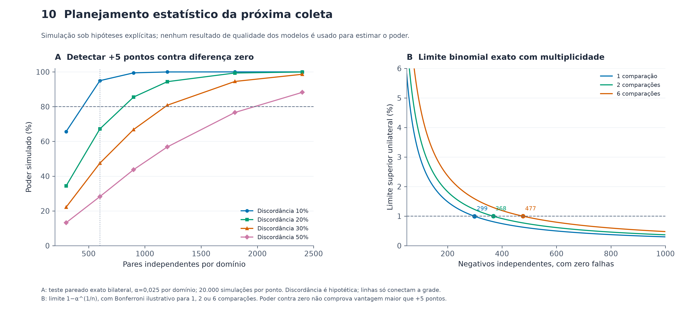

48 cenários de simulação; curva binomial exata determinística; pressupõe independência dos eventos.

[SVG](10_planejamento_amostral.svg) · [PDF](10_planejamento_amostral.pdf) · [PNG 300 dpi](10_planejamento_amostral.png)

### Memória do processo e do sistema

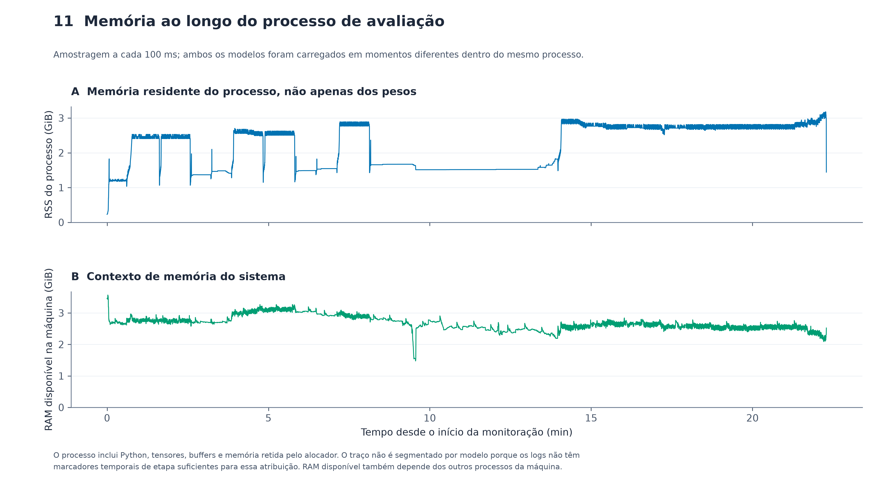

Série temporal de RSS e RAM disponível, 100 ms; sem atribuição de picos a modelos específicos.

[SVG](11_memoria_processo.svg) · [PDF](11_memoria_processo.pdf) · [PNG 300 dpi](11_memoria_processo.png)

### Perfil individual — Laya Vision

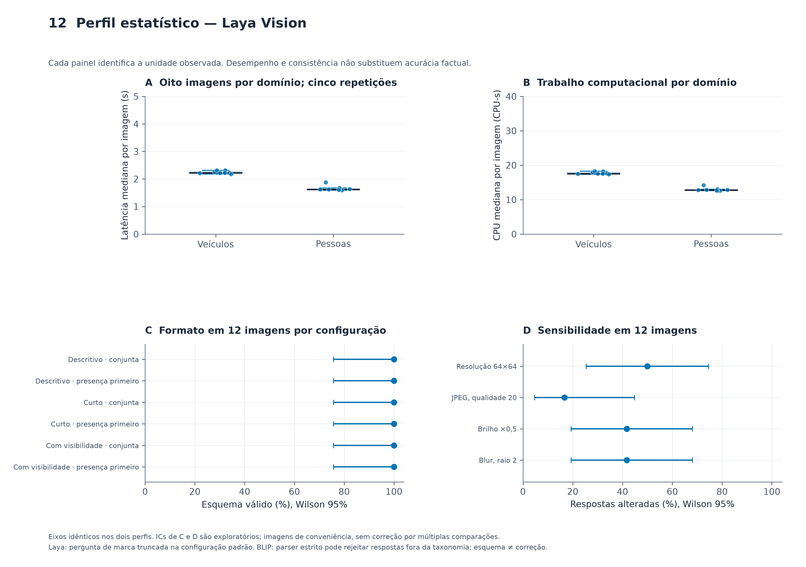

Resumo por modelo; mesmos limites de eixo para comparabilidade; unidades e incerteza especificadas por painel.

[SVG](12_perfil_laya.svg) · [PDF](12_perfil_laya.pdf) · [PNG 300 dpi](12_perfil_laya.png)

### Perfil individual — BLIP VQA

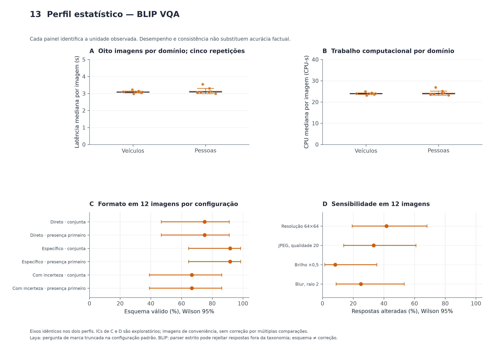

Resumo por modelo; mesmos limites de eixo para comparabilidade; unidades e incerteza especificadas por painel.

[SVG](13_perfil_blip.svg) · [PDF](13_perfil_blip.pdf) · [PNG 300 dpi](13_perfil_blip.png)

## Dados e reprodução

[Estatísticas dos gráficos](estatisticas_dos_graficos.csv) · [Observações de desempenho](observacoes_desempenho.csv) · [Todos os experimentos](observacoes_experimentos.csv) · [Auditoria de tokens](auditoria_orcamento.csv) · [Inferências por orçamento](inferencias_orcamento.csv) · [Poder simulado](simulacao_poder.csv) · [Proveniência e hashes](proveniencia.json)

Reprodução em diretório novo: `.venv/bin/python eval/plot_scientific_description_results.py --output eval/figures/nova_execucao`.

[Relatório empírico de origem](../../experiments/automated_pilot_20261026/report.md). Nenhum resultado anterior foi sobrescrito.
