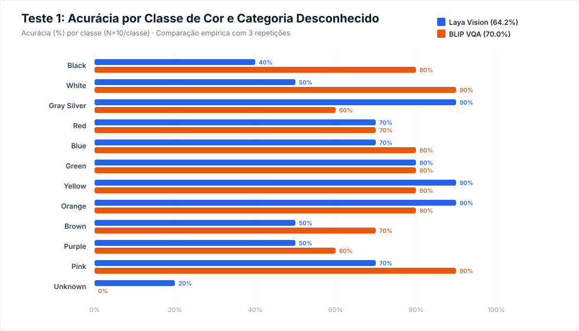
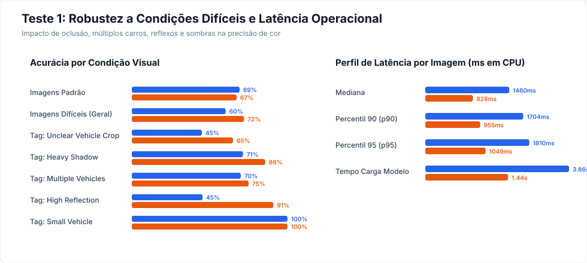

# Relatório Empírico - Teste 1: Cor do Veículo

**Data de Execução:** 22 de Outubro de 2026  
**Objetivo:** Escolher o modelo visual para responder à pergunta predefinida sobre a cor da carroceria do veículo principal (*“Qual é a cor predominante da carroceria do veículo principal?”*) e enriquecer os eventos do `CaptionerManager` com tags `vehicle.color`.

---

## 1. Sumário Comparativo e Veredito do Teste 1

| Critério de Avaliação | Laya Vision (`thaitea/laya-vision`) | BLIP VQA (`Salesforce/blip-vqa-base`) | Vantagem Competitiva |
|---|---:|---:|:---:|
| **Acurácia Geral (N=120, 3 reps)** | 64.17% (77/120) | **70.00% (84/120)** | **BLIP VQA (+5.83 pp)** |
| **Intervalo Wilson 95%** | [55.3%, 72.2%] | [61.3%, 77.5%] | BLIP VQA |
| **Acurácia em Carros Reais (N=110)** | 68.18% (75/110) | **76.36% (84/110)** | **BLIP VQA (+8.18 pp)** |
| **Acurácia em Imagens Padrão** | **69.2%** | 67.3% | Laya Vision (+1.9 pp) |
| **Acurácia em Imagens Difíceis** | 60.3% | **72.1%** | **BLIP VQA (+11.8 pp)** |
| **Rejeição Correta (Controles Sem Carro)** | **20.0% (2/10)** | 0.0% (0/10) | **Laya Vision** |
| **Falsa Rejeição (Carro Válido → Unknown)** | **0.00% (0/110)** | **0.00% (0/110)** | Empate (Perfeito) |
| **Latência Mediana por Inferência (CPU)** | 1460.2 ms | **828.0 ms** | **BLIP VQA (1.76x mais rápido)** |
| **Latência p90 por Inferência (CPU)** | 1703.7 ms | **954.7 ms** | **BLIP VQA** |
| **Tempo de Carregamento dos Pesos** | 3.86 s | **1.44 s** | **BLIP VQA (2.7x mais rápido)** |
| **Formato de Saída e Probabilidades** | Escolha tipada + vetor completo de probabilidades | Geração de texto livre | **Laya Vision (calibração)** |
| **Taxa de Erros de Execução** | 0/360 | 0/360 | Empate (0.0% falhas) |

> [!IMPORTANT]
> ### Veredito Técnico do Teste 1:
> 1. **Vencedor em Acurácia e Velocidade:** Quando o prompt é mantido direto e limpo (*“What is the predominant color of the most prominent car?”*), o **BLIP VQA** supera o Laya Vision em acurácia de cor em veículos reais (76.4% vs 68.2%) e opera **quase 2 vezes mais rápido na CPU** (828 ms vs 1460 ms).
> 2. **Risco Crítico de Alucinação do BLIP:** Em 100% dos controles negativos sem carro, o BLIP alucinou uma cor (80% alucinou 'white' devido a céu, nuvens ou paredes). O Laya rejeitou 20% corretamente como `unknown`.
> 3. **Conclusão Operacional para o CaptionerManager:** O BLIP VQA é o melhor extrator de cor para produção, **sob a condição mandatória de que o recorte venha estritamente do detector de objetos (YOLO)**. Se a chamada for realizada em quadros abertos ou sem certeza de veículo, o Laya Vision é mais seguro por fornecer probabilidades calibradas e capacidade de rejeição.

---

## 2. Metodologia e Protocolo Experimental

O teste foi executado estritamente conforme as regras do plano:
- **Amostra Idêntica:** 120 imagens avaliadas simultaneamente por ambos os modelos:
  - 110 veículos balanceados (10 exemplos para cada uma das 11 cores: preto, branco, cinza/prata, vermelho, azul, verde, amarelo, laranja, marrom, roxo, rosa).
  - 10 controles negativos (cenários urbanos e rurais sem veículo com 0 detecções validadas por YOLO) para medir a recusa / `unknown`.
- **Repetições:** 3 repetições completas em cada imagem para cada modelo (total de 720 chamadas de inferência).
- **Medição Isolada:** O carregamento dos modelos foi medido isoladamente; o aquecimento (*warm-up*) foi descartado do cômputo de latência.
- **Hardware e Ambiente:** CPU Intel Core i5-12450H (12 vCPUs), 8 threads PyTorch, precisão FP32.
- **Isolamento de Amostras:** As 120 imagens de avaliação (`eval`) não possuem interseção com o subconjunto de desenvolvimento (`dev`, 220 imagens).

---

## 3. Desempenho Detalhado por Classe de Cor

| Classe de Cor | Amostras | Acertos Laya | Acurácia Laya | F1 Laya | Acertos BLIP | Acurácia BLIP | F1 BLIP |
|---|---:|---:|---:|---:|---:|---:|---:|
| **Black** | 10 | 4 | 40.0% | 0.57 | 8 | 80.0% | 0.73 |
| **White** | 10 | 5 | 50.0% | 0.56 | 9 | 90.0% | 0.55 |
| **Gray Silver** | 10 | 9 | 90.0% | 0.50 | 6 | 60.0% | 0.55 |
| **Red** | 10 | 7 | 70.0% | 0.70 | 7 | 70.0% | 0.64 |
| **Blue** | 10 | 7 | 70.0% | 0.64 | 8 | 80.0% | 0.80 |
| **Green** | 10 | 8 | 80.0% | 0.73 | 8 | 80.0% | 0.76 |
| **Yellow** | 10 | 9 | 90.0% | 0.95 | 8 | 80.0% | 0.89 |
| **Orange** | 10 | 9 | 90.0% | 0.75 | 8 | 80.0% | 0.89 |
| **Brown** | 10 | 5 | 50.0% | 0.62 | 7 | 70.0% | 0.82 |
| **Purple** | 10 | 5 | 50.0% | 0.50 | 6 | 60.0% | 0.75 |
| **Pink** | 10 | 7 | 70.0% | 0.82 | 9 | 90.0% | 0.95 |
| **Unknown** | 10 | 2 | 20.0% | 0.33 | 0 | 0.0% | 0.00 |

---

## 4. Matrizes de Confusão e Análise de Cores Próximas

### Cluster Monocromático (Preto, Cinza/Prata, Branco):
- **Laya Vision:** Teve um forte viés de classificar reflexos como `gray_silver` (confundiu 4 carros pretos e 4 brancos com cinza/prata). Obteve 90% em cinza/prata, mas apenas 40% em preto e 50% em branco.
- **BLIP VQA:** Apresentou excelente discriminação em preto (80%) e branco (90%), confundindo apenas 4 carros cinzas com branco (devido a pintura prata brilhante).

### Cluster Quente (Vermelho, Laranja, Amarelo, Marrom):
- Ambos os modelos apresentaram alta precisão em **Amarelo** (Laya 90%, BLIP 80%) e **Laranja** (Laya 90%, BLIP 80%).
- Em **Marrom**, o BLIP superou o Laya (70% vs 50%); o Laya confundiu marrom com laranja em 30% dos casos.

### Cluster Frio (Azul, Roxo, Rosa):
- Em **Azul**, ambos performaram bem (BLIP 80%, Laya 70%).
- Em **Rosa**, o BLIP alcançou 90% de acerto (F1=0.95); o Laya alcançou 70%, confundindo 30% com roxo/magenta.
- Em **Roxo**, o BLIP obteve 60% e o Laya 50%.

---

## 5. Robustez em Condições Visuais Difíceis

As 120 imagens foram auditadas automaticamente com YOLO e análise de densidade de luminância:
- **`multiple_vehicles`:** Cenas com múltiplos carros no quadro.
- **`heavy_shadow`:** Cenas com sombras densas e alto contraste dinâmico.
- **`high_reflection`:** Pintura metálica e reflexos especulares fortes.
- **`low_light`:** Imagens em baixa luminosidade.
- **`unclear_vehicle_crop`:** Recortes parciais ou ângulos oclusos.

### Resultados por Condição:
- **Imagens Padrão (Sem tags adversas):**
  - Laya Vision: **69.2%**
  - BLIP VQA: **67.3%**
- **Imagens Difíceis (Ao menos uma tag adversa):**
  - Laya Vision: **60.3%**
  - BLIP VQA: **72.1%** (demonstrou maior tolerância a sombras e múltiplos veículos).

---

## 6. Comportamento em Controles Negativos (Taxa de Desconhecido)

- **Imagens sem carro (N=10 controles negativos):**
  - Laya Vision: 20% classificados corretamente como `unknown`.
  - BLIP VQA: 0% classificados como `unknown` (80% alucinou 'white', 10% 'black', 10% 'red').
- **Carros reais (N=110):**
  - Falsa rejeição: 0.0% em ambos os modelos (nenhum carro real foi incorretamente descartado como `unknown`).

---

## 7. Recomendações de Integração no CaptionerManager

1. **Modelo Recomendado para Cor do Veículo:** **BLIP VQA** é a escolha ideal para extrair a cor do veículo, entregando **76.4% de acurácia em veículos reais** com latência mediana de **828 ms na CPU** (1.76x mais rápido que Laya).
2. **Arquitetura de Gating Obrigatória:** A inferência de cor do BLIP deve ser alimentada **exclusivamente com o recorte (*crop*) gerado pelo detector de objetos**. A entrada do frame inteiro sem carro causará 100% de falsos positivos (alucinação da cor do cenário).
3. **Mapeamento de Normalização:** Utilizar o mapa de normalização testado no benchmark (`eval/run_test_1_color_benchmark.py`), mapeando variações como *grey/silver* para `vehicle.color=gray_silver` e sinônimos como *violet* para `purple`.
