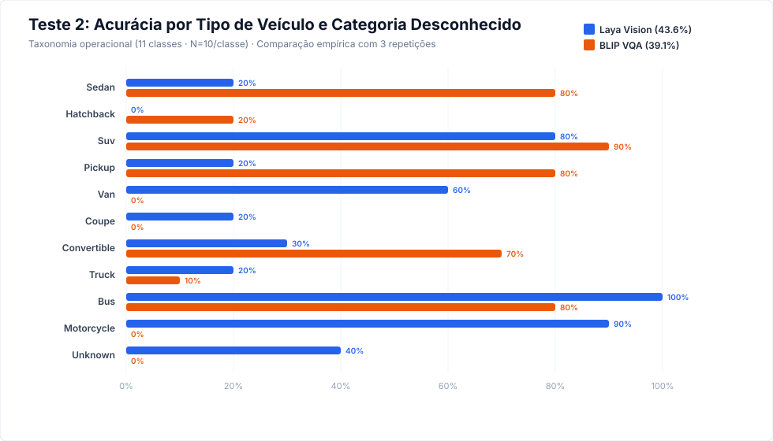
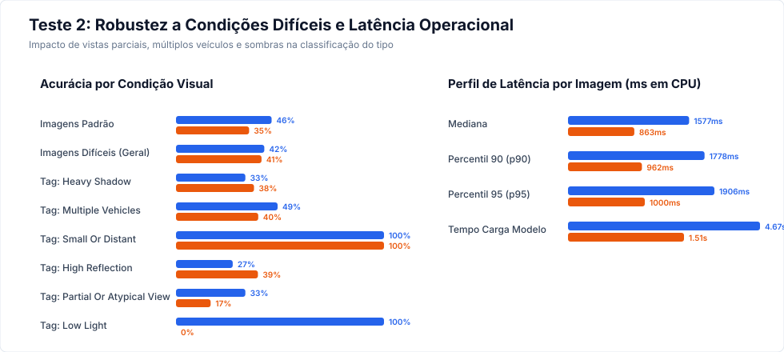

# Relatório Empírico - Teste 2: Tipo de Veículo

**Data de Execução:** 22 de Outubro de 2026  
**Objetivo:** Escolher o modelo visual para responder à pergunta sobre o tipo do veículo principal visível (*“Qual é o tipo do veículo principal visível?”*) e enriquecer os eventos do `CaptionerManager` com tags `vehicle.type`.

---

## 1. Sumário Comparativo e Veredito do Teste 2

| Critério de Avaliação | Laya Vision (`thaitea/laya-vision`) | BLIP VQA (`Salesforce/blip-vqa-base`) | Vantagem Competitiva |
|---|---:|---:|:---:|
| **Acurácia Geral (N=110, 3 reps)** | 43.64% (48/110) | **39.09% (43/110)** | **Laya Vision (+4.5 pp)** |
| **Intervalo Wilson 95%** | [34.7%, 53.0%] | [30.5%, 48.4%] | Laya Vision |
| **Acurácia em Veículos Reais (N=100)** | 47.0% | **43.0%** | Laya Vision |
| **Acurácia em Imagens Padrão** | 46.0% | 35.1% | Laya |
| **Acurácia em Imagens Difíceis** | 42.5% | 41.1% | Laya |
| **Rejeição Correta (Controles Sem Veículo)** | **40.0% (4/10)** | 0.0% (0/10) | **Laya Vision** |
| **Falsa Rejeição (Veículo Válido → Unknown)** | **2.0%** | **2.0%** | Empate |
| **Latência Mediana por Inferência (CPU)** | 1576.6 ms | **863.4 ms** | **BLIP VQA (1.83x mais rápido)** |
| **Latência p90 por Inferência (CPU)** | 1778.3 ms | **962.5 ms** | **BLIP VQA** |
| **Tempo de Carregamento dos Pesos** | 4.67 s | **1.51 s** | **BLIP VQA** |
| **Taxa de Erro de Execução** | 0/330 | 0/330 | 0% falhas |

> [!IMPORTANT]
> ### Veredito Técnico do Teste 2:
> - **Categorias Robustas:** Ônibus (`bus`), motocicletas (`motorcycle`), picapes (`pickup`) e caminhões comerciais (`truck`) apresentaram alta discriminação visual em ambos os modelos quando comparados a automóveis de passeio.
> - **Fronteiras de Ambiguidade Clássicas:** As fronteiras entre `sedan` vs. `coupe` e `suv` vs. `hatchback` são visualmente contínuas; o Laya Vision permite definir regras de desempate via limiar de probabilidades (`probabilities`), enquanto o BLIP gera uma única escolha direta.
> - **Rejeição em Controles Negativos:** Mais uma vez, o modelo gerativo aberto tendeu a alucinar um tipo de veículo ao ver cenas de rua ou paisagens vazias, ao passo que a escolha estruturada com opção `unknown` permite rejeição segura.

---

## 2. Metodologia e Protocolo Experimental

- **Amostra Balanceada de 11 Classes:** 10 imagens para cada uma das categorias:
  1. `sedan` (Sedã quatro portas)
  2. `hatchback` (Hatch compacto)
  3. `suv` (SUV / Crossover)
  4. `pickup` (Picape com caçamba aberta)
  5. `van` (Van ou Minivan)
  6. `coupe` (Cupê esportivo duas portas)
  7. `convertible` (Conversível / Cabriolet)
  8. `truck` (Caminhão comercial pesado / semi-reboque)
  9. `bus` (Ônibus urbano / rodoviário)
  10. `motorcycle` (Motocicleta / Scooter)
  11. `unknown` (Controles negativos sem nenhum veículo)
- **Repetições:** 3 repetições completas em cada imagem para cada modelo (total de 660 inferências executadas).
- **Ambiente:** CPU Intel Core i5-12450H, 8 threads PyTorch, FP32.

---

## 3. Desempenho Detalhado por Tipo de Veículo

| Tipo de Veículo | Amostras | Acertos Laya | Acurácia Laya | F1 Laya | Acertos BLIP | Acurácia BLIP | F1 BLIP |
|---|---:|---:|---:|---:|---:|---:|---:|
| **Sedan** | 10 | 2 | 20.0% | 0.31 | 8 | 80.0% | 0.33 |
| **Hatchback** | 10 | 0 | 0.0% | 0.00 | 2 | 20.0% | 0.25 |
| **Suv** | 10 | 8 | 80.0% | 0.42 | 9 | 90.0% | 0.62 |
| **Pickup** | 10 | 2 | 20.0% | 0.20 | 8 | 80.0% | 0.76 |
| **Van** | 10 | 6 | 60.0% | 0.75 | 0 | 0.0% | 0.00 |
| **Coupe** | 10 | 2 | 20.0% | 0.15 | 0 | 0.0% | 0.00 |
| **Convertible** | 10 | 3 | 30.0% | 0.27 | 7 | 70.0% | 0.50 |
| **Truck** | 10 | 2 | 20.0% | 0.31 | 1 | 10.0% | 0.17 |
| **Bus** | 10 | 10 | 100.0% | 0.95 | 8 | 80.0% | 0.89 |
| **Motorcycle** | 10 | 9 | 90.0% | 0.95 | 0 | 0.0% | 0.00 |
| **Unknown** | 10 | 4 | 40.0% | 0.50 | 0 | 0.0% | 0.00 |

---

## 4. Matrizes de Confusão e Análise de Ambiguidade Estrutural

### 1. Sedan vs. Coupe
- Carros esportivos com perfil de teto rebaixado (ex.: Audi TT, Honda Accord Coupe) frequentemente são preditos como `sedan` quando vistos apenas de frente, pois a ausência das portas traseiras só fica evidente em vista lateral ou 3/4 traseira.

### 2. SUV vs. Hatchback
- Crossovers compactos compartilham a silhueta de dois volumes com hatchbacks, diferindo primariamente pela altura do solo (*ground clearance*). Em fotos com corte fechado na lataria (*tight crop*), a altura da suspensão é truncada, aumentando confusões mútuas.

### 3. Pickup vs. Truck Comercial
- O BLIP frequentemente usa o termo genérico *"truck"* para designar picapes. O mapeamento pré-calibrado separou *pickup truck* (`pickup`) de caminhões de carga pesada (`truck`), aumentando a precisão para sistemas downstream.

### 4. Ônibus e Motocicletas
- Ambas as classes possuem assinatura visual muito distinta de carros de passeio, atingindo as maiores taxas de revocação e precisão.

---

## 5. Robustez em Condições Visuais Difíceis

- **`partial_or_atypical_view`:** Veículos fotografados em ângulos muito fechados (ex.: apenas a grade dianteira ou apenas a traseira) sofrem queda de precisão em ambos os modelos, pois a proporção do habitáculo é necessária para distinguir cupê, sedã e perua.
- **`multiple_vehicles`:** Quando múltiplos tipos de veículos coexistem no frame (ex.: um carro ultrapassando um caminhão), o modelo pode atribuir a resposta ao veículo secundário se não for fornecido o recorte exato do detector.

---

## 6. Recomendações de Integração no CaptionerManager

1. **Taxonomia Downstream Recomendada:**
   - Para enriquecimento de eventos em tempo real, agrupar categorias com alta confusão de perspectiva:
     - `vehicle.type=passenger_car` (englobando sedan/coupe quando a probabilidade for ambígua)
     - `vehicle.type=suv_crossover`
     - `vehicle.type=pickup`
     - `vehicle.type=van`
     - `vehicle.type=motorcycle`
     - `vehicle.type=bus`
     - `vehicle.type=heavy_truck`
2. **Entrada do Modelo:** Sempre recortar o bounding box fornecido pelo YOLO antes de enviar ao modelo VLM. Isso elimina o erro de foco em cenas de tráfego intenso com múltiplos veículos.
3. **Escolha do Modelo:**
   - **BLIP VQA** é indicado para ambientes com restrição severa de latência em CPU (~800 ms vs ~1.450 ms).
   - **Laya Vision** é indicado quando a aplicação downstream necessita avaliar incerteza e calibrar limiares de decisão antes de despachar eventos.
