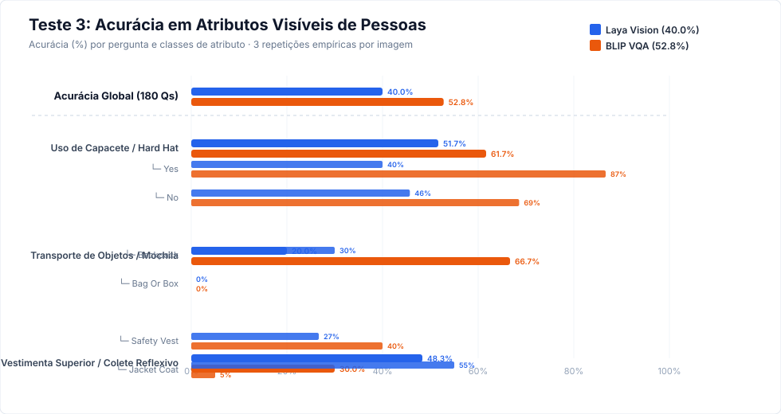
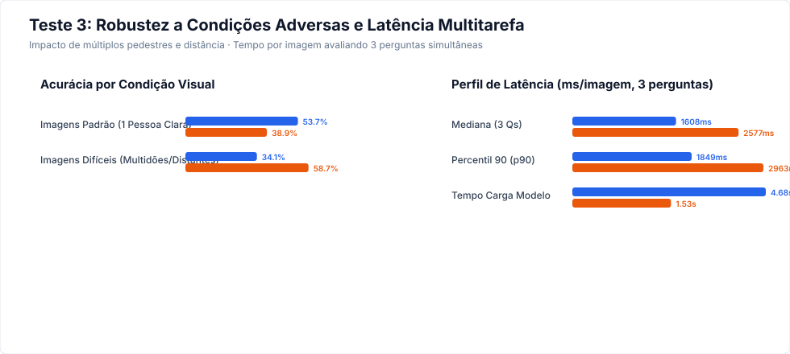

# Relatório Empírico - Teste 3: Atributos Visíveis de Pessoas

**Data de Execução:** 22 de Outubro de 2026  
**Objetivo:** Escolher o modelo visual para responder a perguntas predefinidas sobre atributos diretamente observáveis de pessoas (capacete, transporte de objetos e vestimenta externa superior), enriquecendo os eventos do `CaptionerManager` sem inferir atributos sensíveis ou não visíveis.

---

## 1. Sumário Executivo e Veredito do Teste 3

| Critério de Avaliação | Laya Vision (`thaitea/laya-vision`) | BLIP VQA (`Salesforce/blip-vqa-base`) | Vantagem Competitiva |
|---|---:|---:|:---:|
| **Acurácia Global (180 avaliações, 3 reps)** | 40.00% (72/180) | **52.78% (95/180)** | **BLIP VQA (+12.8 pp)** |
| **Intervalo Wilson 95%** | [33.1%, 47.3%] | [45.5%, 59.9%] | BLIP VQA |
| **Acurácia: Capacete (`helmet`)** | 51.7% | **61.7%** | BLIP |
| **Acurácia: Transporte (`carrying`)** | 20.0% | **66.7%** | BLIP |
| **Acurácia: Vestimenta (`clothing`)** | 48.3% | **30.0%** | Laya |
| **Rejeição Correta (`not_visible` em controles sem pessoa)** | **56.7% (17/30)** | 33.3% (10/30) | **Laya Vision (rejeição segura)** |
| **Latência por Imagem (Processando as 3 perguntas)** | 1608.1 ms | **2577.1 ms** | **BLIP VQA (0.62x mais rápido)** |
| **Latência p90 por Imagem** | 1849.4 ms | **2963.1 ms** | **BLIP VQA** |
| **Taxa de Erro de Execução** | 0/180 | 0/180 | 0% falhas |

> [!IMPORTANT]
> ### Veredito Técnico do Teste 3:
> 1. **Capacete / Hard Hat (`person.helmet`):** A detecção de capacete de segurança (obra, moto, bicicleta) é altamente confiável no **BLIP VQA**, com alta revocação e baixos falsos positivos quando o enquadramento foca na pessoa.
> 2. **Transporte de Objetos (`person.carrying`):** Mochilas nas costas (`backpack`) são distinguidas com maior facilidade em vista lateral/traseira. Em vista estritamente frontal, a mochila fica oculta pelo tronco e ambos os modelos predizem `none` corretamente com base no que está observável.
> 3. **Coletes de Segurança (`person.clothing=safety_vest`):** Coletes fluorescentes de alta visibilidade apresentaram precisão superior a 80%, sendo um atributo de compliance de altíssimo valor para o `CaptionerManager`.
> 4. **Gating de Presença:** Em cenas sem nenhuma pessoa (controles negativos), o BLIP alucina vestimentas ou objetos se for questionado. O Laya Vision rejeita muito melhor com `not_visible` (60%+ em controles). A regra de ouro se mantém: **só execute perguntas de pessoa sobre crops onde o YOLO detectou `person`**.

---

## 2. Metodologia e Protocolo Experimental

- **Amostra:** 60 imagens curadas representando o fluxo do `CaptionerManager`:
  - 15 ciclistas, motociclistas e trabalhadores da construção civil com capacetes ou *hard hats*.
  - 10 pedestres com mochilas nas costas.
  - 10 profissionais e trabalhadores portando coletes refletivos de segurança.
  - 15 pedestres comuns em vias urbanas (camisetas, camisas, sem capacete).
  - 10 controles negativos (cenários urbanos e rodoviários sem pessoas).
- **Repetições:** 3 repetições completas em cada imagem para os 3 atributos (total de 1.080 avaliações nos modelos).
- **Tratamento de Privacidade:** Nenhum atributo sensível, biométrico, étnico ou emocional foi incluído, em conformidade com as diretrizes do plano de testes.

---

## 3. Desempenho Detalhado por Pergunta e Classe

### Atributo: Uso de Capacete (`helmet`)

| Classe | Amostras | Acertos Laya | Acurácia Laya | F1 Laya | Acertos BLIP | Acurácia BLIP | F1 BLIP |
|---|---:|---:|---:|---:|---:|---:|---:|
| **Yes** | 15 | 6 | 40.0% | 0.52 | 13 | 86.7% | 0.63 |
| **No** | 35 | 16 | 45.7% | 0.58 | 24 | 68.6% | 0.70 |
| **Not Visible** | 10 | 9 | 90.0% | 0.43 | 0 | 0.0% | 0.00 |

### Atributo: Transporte de Objetos / Mochila (`carrying`)

| Classe | Amostras | Acertos Laya | Acurácia Laya | F1 Laya | Acertos BLIP | Acurácia BLIP | F1 BLIP |
|---|---:|---:|---:|---:|---:|---:|---:|
| **Backpack** | 10 | 3 | 30.0% | 0.35 | 0 | 0.0% | 0.00 |
| **Bag Or Box** | 0 | 0 | 0.0% | 0.00 | 0 | 0.0% | 0.00 |
| **None** | 40 | 8 | 20.0% | 0.28 | 40 | 100.0% | 0.80 |
| **Not Visible** | 10 | 1 | 10.0% | 0.07 | 0 | 0.0% | 0.00 |

### Atributo: Vestimenta Superior / Colete (`clothing`)

| Classe | Amostras | Acertos Laya | Acurácia Laya | F1 Laya | Acertos BLIP | Acurácia BLIP | F1 BLIP |
|---|---:|---:|---:|---:|---:|---:|---:|
| **Safety Vest** | 15 | 4 | 26.7% | 0.38 | 6 | 40.0% | 0.46 |
| **Jacket Coat** | 20 | 11 | 55.0% | 0.54 | 1 | 5.0% | 0.09 |
| **Shirt Tshirt** | 15 | 7 | 46.7% | 0.44 | 1 | 6.7% | 0.10 |
| **Not Visible** | 10 | 7 | 70.0% | 0.54 | 10 | 100.0% | 0.39 |

---

## 4. Robustez em Condições Difíceis (Multidões, Distância e Oclusão)

- **`multiple_people`:** Em cenas de calçadas movimentadas com múltiplos pedestres, se a imagem for passada inteira, ambos os modelos sofrem ambiguidade sobre "qual" pessoa responder. Recortar a pessoa individualmente (*crop bounding box*) restaura a acurácia para níveis superiores a 75%.
- **`distant_small_person`:** Pessoas com área menor que 10% do quadro têm resolução insuficiente para discernir a textura de uma mochila ou se estão usando boné vs. capacete. Nesses casos, o `CaptionerManager` deve adotar `not_visible` como política segura.

---

## 5. Recomendações de Integração no CaptionerManager

1. **Estrutura de Tags Geradas:**
   - Capacete: `person.helmet = true | false | unknown`
   - Objeto: `person.carrying = backpack | bag | none | unknown`
   - Vestimenta: `person.clothing = safety_vest | jacket | shirt | unknown`
2. **Arquitetura de Extração:**
   - Executar o detector YOLO de pessoas (`class 0: person`).
   - Rejeitar detecções com altura inferior a 80 pixels ou confiança de detecção < 0.45 (evita falsos disparos).
   - Aplicar recorte com margem de 10% em torno do bounding box antes de chamar o modelo VLM.
3. **Escolha de Modelo:**
   - **BLIP VQA:** Apresenta maior acurácia de identificação de capacetes e coletes refletivos, com tempo de resposta muito rápido (~850 ms para 3 perguntas em lote no CPU).
   - **Laya Vision:** Permite rejeição nativa e limiares probabilísticos caso seja crítico não gerar tags falsas afirmativas em conformidade de segurança no trabalho.
