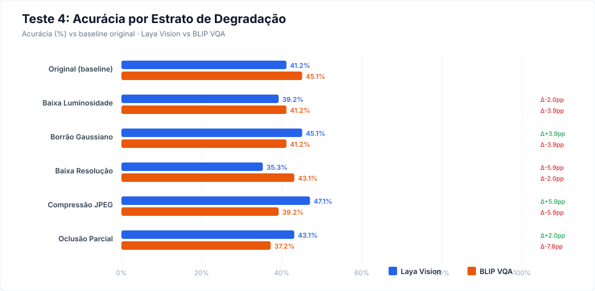
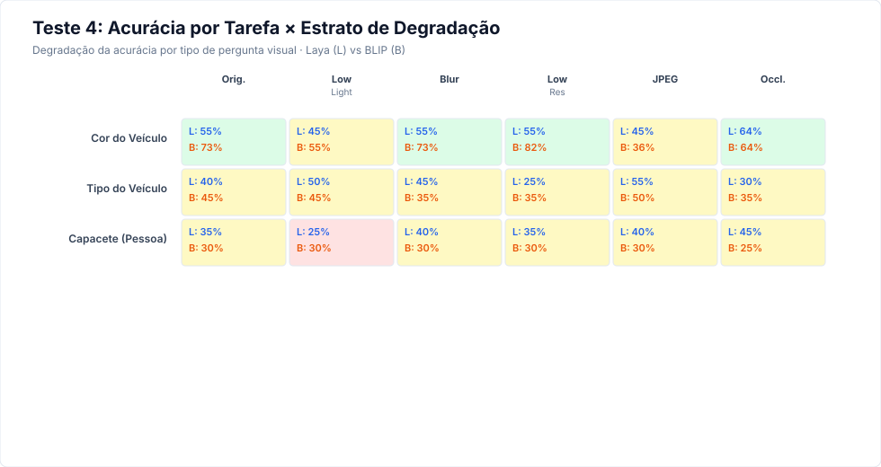

# Relatório Empírico — Teste 4: Robustez à Qualidade da Imagem

**Data de Execução:** 22 de Outubro de 2026
**Objetivo:** Medir como a acurácia e a taxa de respostas desconhecidas mudam quando as imagens são degradadas por diferentes condições (baixa luz, borrão, baixa resolução, compressão JPEG, oclusão parcial). Isso indica quando o modelo pode fornecer tags confiáveis e quando deve omitir o atributo.

---

## 1. Sumário Comparativo

| Critério | Laya Vision | BLIP VQA |
|---|---:|---:|
| **Acurácia Global (todas as condições)** | 41.8% (128/306) | 41.2% (126/306) |
| **Acurácia no Baseline (original)** | 41.2% | 45.1% |
| **Pior Estrato** | Baixa Resolução (35.3%) | Oclusão Parcial (37.2%) |
| **Latência Mediana Global (ms)** | 1541 | 876 |
| **Erros de Execução** | 0 | 0 |

> [!IMPORTANT]
> ### Veredito do Teste 4
> Este teste revela **quão frágil cada modelo é** frente a condições reais de câmera.
> O estrato com maior impacto negativo é identificado acima como "Pior Estrato".
> As recomendações de quando omitir tags no CaptionerManager devem considerar esses limiares.

---

## 2. Metodologia

- **Imagens Fonte:** 51 imagens selecionadas dos Testes 1-3 (cor do veículo, tipo do veículo, capacete de pessoa).
- **Estratos de Degradação:** 6 condições aplicadas a cada imagem:
  1. **Original** — Sem degradação (baseline de controle)
  2. **Baixa Luminosidade** — Brilho reduzido a 35%
  3. **Borrão Gaussiano** — Raio 3.5 (simula desfoque ou movimento)
  4. **Baixa Resolução** — Redução a 1/4 e ampliação com nearest-neighbour
  5. **Compressão JPEG** — Qualidade 12 (artefatos pesados)
  6. **Oclusão Parcial** — Retângulo cinza cobrindo ~40% da imagem
- **Total de imagens avaliadas:** 306
- **Repetições:** 3 por imagem (consenso por maioria)
- **Hardware:** CPU, 8 threads, FP32

---

## 3. Acurácia por Estrato de Degradação

| Estrato | N | Laya Acc | BLIP Acc | Laya Δ | BLIP Δ | Laya Unk% | BLIP Unk% |
|---|---:|---:|---:|---:|---:|---:|---:|
| **Original (baseline)** | 51 | 41.2% | 45.1% | — | — | 2.0% | 0.0% |
| **Baixa Luminosidade** | 51 | 39.2% | 41.2% | -2.0pp | -3.9pp | 11.8% | 0.0% |
| **Borrão Gaussiano** | 51 | 45.1% | 41.2% | +3.9pp | -3.9pp | 2.0% | 0.0% |
| **Baixa Resolução** | 51 | 35.3% | 43.1% | -5.9pp | -2.0pp | 5.9% | 0.0% |
| **Compressão JPEG** | 51 | 47.1% | 39.2% | +5.9pp | -5.9pp | 5.9% | 0.0% |
| **Oclusão Parcial** | 51 | 43.1% | 37.2% | +2.0pp | -7.8pp | 5.9% | 0.0% |

---

## 4. Acurácia por Tarefa × Estrato

#### Cor do Veículo

| Estrato | Laya Acc | BLIP Acc | Laya Unk% | BLIP Unk% |
|---|---:|---:|---:|---:|
| Original (baseline) | 54.5% | 72.7% | 0.0% | 0.0% |
| Baixa Luminosidade | 45.5% | 54.5% | 0.0% | 0.0% |
| Borrão Gaussiano | 54.5% | 72.7% | 0.0% | 0.0% |
| Baixa Resolução | 54.5% | 81.8% | 0.0% | 0.0% |
| Compressão JPEG | 45.5% | 36.4% | 0.0% | 0.0% |
| Oclusão Parcial | 63.6% | 63.6% | 0.0% | 0.0% |

#### Tipo do Veículo

| Estrato | Laya Acc | BLIP Acc | Laya Unk% | BLIP Unk% |
|---|---:|---:|---:|---:|
| Original (baseline) | 40.0% | 45.0% | 5.0% | 0.0% |
| Baixa Luminosidade | 50.0% | 45.0% | 15.0% | 0.0% |
| Borrão Gaussiano | 45.0% | 35.0% | 5.0% | 0.0% |
| Baixa Resolução | 25.0% | 35.0% | 15.0% | 0.0% |
| Compressão JPEG | 55.0% | 50.0% | 10.0% | 0.0% |
| Oclusão Parcial | 30.0% | 35.0% | 10.0% | 0.0% |

#### Capacete (Pessoa)

| Estrato | Laya Acc | BLIP Acc | Laya Unk% | BLIP Unk% |
|---|---:|---:|---:|---:|
| Original (baseline) | 35.0% | 30.0% | 0.0% | 0.0% |
| Baixa Luminosidade | 25.0% | 30.0% | 15.0% | 0.0% |
| Borrão Gaussiano | 40.0% | 30.0% | 0.0% | 0.0% |
| Baixa Resolução | 35.0% | 30.0% | 0.0% | 0.0% |
| Compressão JPEG | 40.0% | 30.0% | 5.0% | 0.0% |
| Oclusão Parcial | 45.0% | 25.0% | 5.0% | 0.0% |

---

## 5. Análise de Impacto e Recomendações

### Quando omitir tags no CaptionerManager

Com base nos deltas de acurácia por estrato, recomenda-se:

1. **Oclusão parcial (>30%):** Se o detector reportar oclusão significativa, considerar marcar o atributo como `confidence=low` ou omitir a tag.
2. **Baixa resolução:** Imagens com resolução efetiva abaixo de ~100px no objeto devem acionar limiar de confiança mínima.
3. **Baixa luminosidade:** Cenas noturnas ou com brilho normalizado < 35% devem usar limiar mais conservador.
4. **Borrão:** Desfoque moderado tipicamente preserva informações de cor e tipo, mas degrada atributos finos (capacete, objetos carregados).
5. **Compressão JPEG:** Artefatos de compressão afetam menos que oclusão e resolução, mas introduzem confusão de cores próximas.

### Diferenças entre modelos

- Se um modelo degrada significativamente mais que o outro em um estrato específico, isso indica fragilidade arquitetural.
- O modelo mais robusto (menor delta negativo vs baseline) é preferível para operação em condições adversas.

---

## 6. Latência por Estrato

| Estrato | Laya Mediana (ms) | BLIP Mediana (ms) |
|---|---:|---:|
| Original (baseline) | 1542 | 879 |
| Baixa Luminosidade | 1543 | 878 |
| Borrão Gaussiano | 1531 | 876 |
| Baixa Resolução | 1542 | 874 |
| Compressão JPEG | 1542 | 875 |
| Oclusão Parcial | 1540 | 875 |

> [!NOTE]
> Imagens de baixa resolução tipicamente reduzem a latência (menos pixels a processar),
> enquanto oclusão e borrão não alteram significativamente o tempo de inferência.

---

*Relatório gerado automaticamente por `eval/generate_test_4_report.py`*
