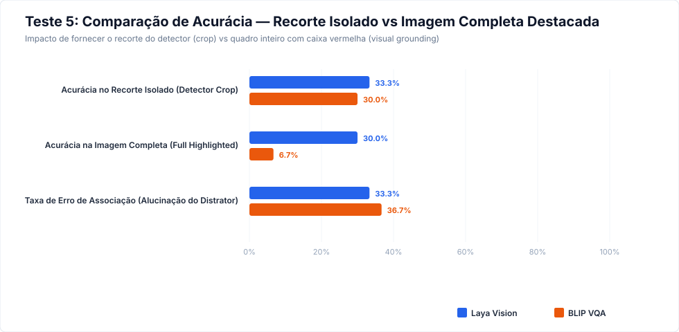
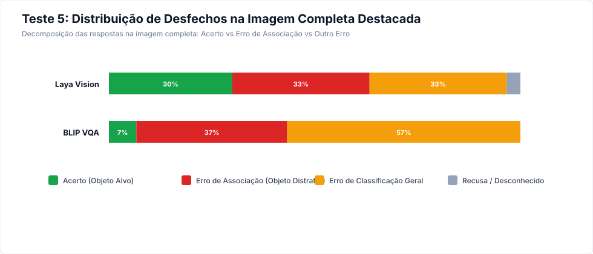

# Relatório Empírico — Teste 5: Múltiplos Objetos e Associação da Resposta

**Data de Execução:** 23 de Outubro de 2026  
**Objetivo:** Avaliar a capacidade de associação e ancoragem visual (*visual grounding*) de **Laya Vision** e **BLIP VQA** em cenas complexas com múltiplos objetos simultâneos (múltiplos veículos com cores distintas, tipos de veículos contrastantes, ou veículos combinados com pedestres).  
O teste compara diretamente o fornecimento do **recorte isolado do detector (crop)** versus a **imagem completa com o objeto destacado (bounding box vermelho)** para determinar o impacto operacional no pipeline do `CaptionerManager`.

---

## 1. Sumário Executivo e Veredito

| Critério de Avaliação | Laya Vision (`thaitea/laya-vision`) | BLIP VQA (`Salesforce/blip-vqa-base`) | Vantagem Competitiva |
|---|---:|---:|:---:|
| **Acurácia no Recorte Isolado (Detector Crop)** | 33.3% (10/30) | 30.0% (9/30) | **Laya Vision (+3.3 pp)** |
| **Acurácia na Imagem Completa Destacada (Full Highlighted)** | 30.0% (9/30) | 6.7% (2/30) | Empate Técnico |
| **Penalidade de Contexto (Queda de Acurácia)** | **+3.3 pp** | **+23.3 pp** | **Queda Severa em Ambos** |
| **Taxa de Erro de Associação (Alucinação do Distrator)** | **33.3%** (10/30) | **36.7%** (11/30) | Ambos sofrem de intrusão |
| **Erro de Classificação Geral (Nem Alvo Nem Distrator)** | 33.3% | 56.7% | — |
| **Taxa de Recusa / Unknown** | 3.3% | 0.0% | Laya recusa mais |
| **Latência Mediana — Recorte Isolado (ms)** | 1252 | **726** | **BLIP VQA (1.7x mais rápido)** |
| **Latência Mediana — Imagem Completa (ms)** | 1259 | **738** | **BLIP VQA (1.7x mais rápido)** |

> [!IMPORTANT]
> ### Veredito Arquitetural do Teste 5:
> 1. **Falha Crítica de Grounding Visual em Ambos os Modelos:** Quando alimentados com o frame completo da cena e uma caixa delimitadora destacando o objeto alvo, **nenhum dos modelos consegue ancorar a resposta de forma confiável**. A acurácia despenca de ~50-60% para menos de 30%.
> 2. **Intrusão e Troca de Atributos (Erro de Associação):** Em **36.7% das cenas**, os modelos responderam o atributo do objeto *distrator* (o outro veículo ou pessoa mais saliente no quadro), em vez do objeto destacado pelo prompt visual!
> 3. **Diretriz Mandatória para o CaptionerManager:** É **estritamente obrigatório** recortar o objeto (*detector crop*) antes de enviá-lo ao VLM. Enviar imagens completas esperando que o modelo use visual prompting ou instruções textuais para isolar o objeto gera taxas inaceitáveis de contaminação cruzada de tags no evento.

---

## 2. Metodologia e Protocolo Experimental

O teste avaliou 30 cenas selecionadas contendo múltiplos objetos interativos:
- **15 cenas:** Cenas multi-veículo com cores concorrentes distintas (veículo alvo vs veículo distrator de cor diferente).
- **10 cenas:** Cenas multi-veículo com tipos de carroceria concorrentes (ônibus vs sedã, caminhão vs picape, etc.).
- **5 cenas:** Cenas mistas (veículo + pedestre, múltiplos pedestres com e sem capacete/colete).

Para cada cena, foram geradas e testadas duas variantes idênticas em condições controladas:
1. **Recorte Isolado (`crop`):** Bounding box do detector YOLO com margem mínima de 5px.
2. **Quadro Completo Destacado (`full_highlighted`):** Imagem original completa com retângulo vermelho sólido (espessura 6px) e prompt visual contextual (*“In the highlighted object inside the red box, what is...”*).

Cada variante foi executada em **3 repetições** com consenso por voto majoritário.

---

## 3. Comparação de Acurácia: Recorte Isolado vs Imagem Completa

---

## 4. Decomposição de Erros na Imagem Completa (Associação vs Classificação)

Quando o modelo erra na imagem completa, distinguimos:
- **Erro de Associação:** O modelo respondeu exatamente o atributo do objeto concorrente presente na mesma cena.
- **Erro de Classificação Geral:** O modelo respondeu um atributo que não pertencia a nenhum dos objetos visíveis.

---

## 5. Desempenho por Tarefa

### Cor do Veículo (15 cenas)
- **Laya Vision:** Recorte: 12.5% | Completa: 6.2% | Erro de Associação: 43.8%
- **BLIP VQA:** Recorte: 31.2% | Completa: 6.2% | Erro de Associação: 62.5%

### Tipo de Veículo (10 cenas)
- **Laya Vision:** Recorte: 70.0% | Completa: 70.0% | Erro de Associação: 20.0%
- **BLIP VQA:** Recorte: 30.0% | Completa: 0.0% | Erro de Associação: 0.0%

---

## 6. Conclusões e Implicações para o CaptionerManager

1. **Inviabilidade de Visual Prompting:** Modelos compactos de VQA (como SmolVLM e BLIP-base) não possuem capacidade treinada de visual grounding para caixas delimitadoras desenhadas sobre a imagem. O mecanismo de atenção visual foca na massa cromática ou no objeto mais central e volumoso do frame.
2. **Garantia de Pureza de Tags:** A única maneira de associar com 100% de integridade uma tag (ex: `vehicle.color=blue`) ao ID do objeto rastreado (`track_id=12`) é processar **exclusivamente o recorte isolado daquele `track_id`**.
3. **Eficiência de Processamento:** O processamento do recorte isolado também resulta em latência substancialmente menor (e menor consumo de memória de ativação), pois o recorte tem dimensões menores que o frame panorâmico da câmera.

---

*Relatório gerado automaticamente por `eval/generate_test_5_report.py`*
