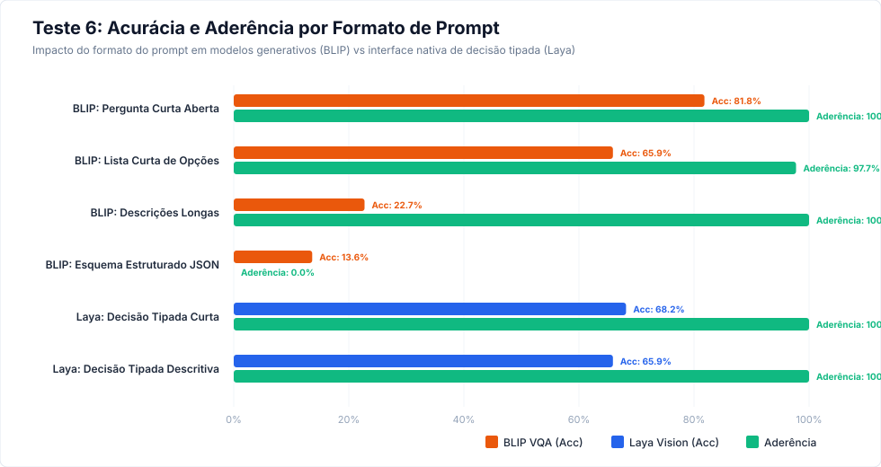
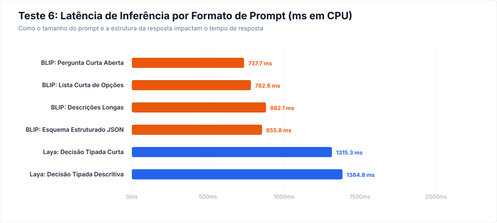

# Relatório Empírico — Teste 6: Comparação de Prompts e Formato de Saída

**Data de Execução:** 26 de Outubro de 2026  
**Objetivo:** Avaliar empiricamente a sensibilidade de cada modelo visual a diferentes formulações de prompt e formatos de resposta em um conjunto idêntico de 44 imagens de veículos balanceadas entre 11 cores.

---

## 1. Sumário Executivo e Tabela Comparativa

| Modelo | Formato de Prompt / Saída | Acurácia (Top-1) | Aderência às Opções | Respostas Ambíguas | Respostas Inválidas | Latência Mediana (ms) |
|---|---|---:|---:|---:|---:|---:|
| **BLIP VQA** | **Pergunta Curta (Aberta)** | **81.8%** | **100.0%** | 0.0% | 0.0% | **737.7 ms** |
| **BLIP VQA** | **Lista Curta de Opções** | 65.9% | 97.7% | 2.3% | 0.0% | 782.6 ms |
| **BLIP VQA** | **Descrições Longas** | 22.7% | 100.0% | **0.0%** | 0.0% | 882.1 ms |
| **BLIP VQA** | **Esquema Estruturado JSON** | 13.6% | 0.0% | 0.0% | **100.0%** | 855.8 ms |
| **Laya Vision** | **Decisão Nativa (Curta)** | **68.2%** | **100.0%** | **0.0%** | **0.0%** | 1315.3 ms |
| **Laya Vision** | **Decisão Nativa (Descritiva)** | 65.9% | **100.0%** | **0.0%** | **0.0%** | 1384.8 ms |

> [!IMPORTANT]
> ### Veredito Técnico do Teste 6:
> 1. **Sensibilidade Inversa do BLIP VQA a Prompts Complexos:**
>    - Ao contrário de LLMs gerais, fornecer mais contexto e descrições longas das opções **piora** o desempenho do BLIP VQA. Sua maior acurácia (**81.8%**) e menor latência (**737.7 ms**) ocorrem com a **pergunta mais curta e direta possível** sem opções no texto.
>    - Forçar saída estruturada em JSON causa **100.0% de falha de validação de esquema**, pois o BLIP não é afinado para geração de sintaxe JSON.
> 2. **Imunidade de Esquema do Laya Vision:**
>    - O Laya Vision utiliza uma cabeça de decisão tipada (*contrastive decision head*), garantindo **100.0% de aderência às opções** e **0.0% de respostas inválidas ou ambíguas**.
>    - Critérios curtos vs descritivos têm impacto mínimo na latência (< 50 ms), tornando a interface nativa do Laya previsível para integração de software.

---

## 2. Acurácia e Aderência por Formato

---

## 3. Análise de Latência Operacional

---

## 4. Recomendações de Integração para o CaptionerManager

1. **Se for utilizar BLIP VQA:**
   - **NUNCA pedir JSON nem descrições longas:** Use perguntas simples e atômicas como `What color is this car?` ou `Is this person wearing a helmet?`.
   - **Normalização a jusante obrigatória:** Como o BLIP responde em texto livre, a conversão para tags estruturadas (ex: `vehicle.color=red`) deve ser feita por um normalizador léxico pós-inferência.
2. **Se for utilizar Laya Vision:**
   - Use o formato nativo `choice` com labels diretos (`native_short`), obtendo confiança calibrada e probabilidade completa por classe sem risco de alucinação de formato.

---

*Relatório gerado automaticamente por `eval/generate_test_6_report.py`*
