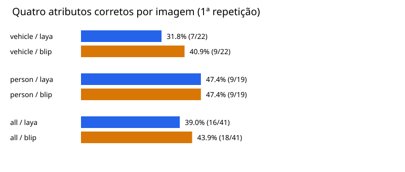

# Teste 7 — Entrega completa de atributos por imagem

Amostra revisada: **41 imagens**, quatro campos por imagem, 3 repetições por modelo. CPU, 8 threads.

Acurácia principal: todos os quatro campos corretos simultaneamente na primeira repetição. As repetições medem latência e estabilidade; não aumentam o número de imagens independentes.

## Resultado por evento completo

| Domínio | Modelo | Eventos completos corretos | Positivos completos corretos | Campos corretos | Latência mediana / p90 (ms) |
|---|---|---:|---:|---:|---:|
| vehicle | laya | 7/22 (31.8%) | 5/20 (25.0%) | 66/88 (75.0%) | 2361.0 / 2554.0 |
| vehicle | blip | 9/22 (40.9%) | 7/20 (35.0%) | 70/88 (79.5%) | 3193.4 / 3817.5 |
| person | laya | 9/19 (47.4%) | 2/12 (16.7%) | 58/76 (76.3%) | 1658.0 / 2161.2 |
| person | blip | 9/19 (47.4%) | 2/12 (16.7%) | 61/76 (80.3%) | 3209.1 / 3914.5 |
| all | laya | 16/41 (39.0%) | 7/32 (21.9%) | 124/164 (75.6%) | 2299.3 / 2445.8 |
| all | blip | 18/41 (43.9%) | 9/32 (28.1%) | 131/164 (79.9%) | 3199.0 / 3877.2 |

**Melhor entrega completa nos casos positivos desta amostra: BLIP.** Compare também os domínios separadamente. Uma saída com quatro campos válidos pode conter quatro erros; formato e correção são medidos separadamente.

Nos 32 casos com objeto presente, o conjunto inteiro ficou correto em 7 imagens para Laya e 9 para BLIP. A diferença é exploratória e não sustenta uma escolha definitiva. Nenhum dos dois demonstrou entrega completa confiável nesta configuração; revisão ou tratamento explícito de falhas continua necessário.

## Atributos, abstenções e erros

| Domínio | Campo | Modelo | Acertos (todos) | Acertos com valor observável |
|---|---|---|---:|---:|
| vehicle | presence | laya | 22/22 (100.0%) | 22/22 (100.0%) |
| vehicle | presence | blip | 22/22 (100.0%) | 22/22 (100.0%) |
| vehicle | make | laya | 9/22 (40.9%) | 7/20 (35.0%) |
| vehicle | make | blip | 17/22 (77.3%) | 15/20 (75.0%) |
| vehicle | color | laya | 19/22 (86.4%) | 17/20 (85.0%) |
| vehicle | color | blip | 18/22 (81.8%) | 16/20 (80.0%) |
| vehicle | body | laya | 16/22 (72.7%) | 14/20 (70.0%) |
| vehicle | body | blip | 13/22 (59.1%) | 11/20 (55.0%) |
| person | helmet | laya | 10/19 (52.6%) | 2/10 (20.0%) |
| person | helmet | blip | 17/19 (89.5%) | 10/10 (100.0%) |
| person | carrying | laya | 13/19 (68.4%) | 3/9 (33.3%) |
| person | carrying | blip | 10/19 (52.6%) | 3/9 (33.3%) |
| person | clothing | laya | 16/19 (84.2%) | 9/10 (90.0%) |
| person | clothing | blip | 15/19 (78.9%) | 8/10 (80.0%) |
| person | presence | laya | 19/19 (100.0%) | 19/19 (100.0%) |
| person | presence | blip | 19/19 (100.0%) | 19/19 (100.0%) |

Os valores `unknown` e `not_visible` são abstenções explícitas. No normalizador de pessoas, respostas não reconhecidas viram `invalid`. Para veículos, o normalizador histórico pode retornar `unknown` ou `other` para respostas genéricas; esses casos ficam visíveis nos dados brutos. A validade de formato abaixo verifica a lista de opções de cada campo e não implica correção visual.

| Modelo | Eventos com campos inválidos (1ª execução) | Erros de execução (todas) | Imagens com variação entre repetições | Tempo de carga (s) |
|---|---:|---:|---:|---:|
| laya | 0/41 | 0 | 0/41 | 5.42 |
| blip | 6/41 | 0 | 0/41 | 0.54 |

## Controles sem objeto

| Domínio | Modelo | Presença falsamente positiva | Atributos indevidos antes do filtro | Atributos indevidos após filtro |
|---|---|---:|---:|---:|
| vehicle | laya | 0/2 | 2/2 | 0/2 |
| vehicle | blip | 0/2 | 2/2 | 0/2 |
| person | laya | 0/7 | 3/7 | 0/7 |
| person | blip | 0/7 | 7/7 | 0/7 |

## Método e limites

- Veículos: presença, marca, cor e carroceria. Pessoas: presença, capacete, transporte de objeto e roupa superior.
- BLIP: quatro perguntas curtas abertas, processadas em batch; normalização lexical local. Laya: quatro decisões tipadas em uma chamada, com opções fixas para todas as imagens. Nenhuma opção depende do gabarito; todas as 48 marcas conhecidas do comparador estão disponíveis.
- Ambos executam os quatro campos. Quando a presença prevista é `no`, o mesmo filtro substitui os outros três campos por ausência. Respostas anteriores ao filtro são preservadas.
- Latência inclui preparação dos tensores, inferência dos quatro campos, normalização e filtro. Leitura de arquivo, carga do modelo e warm-up ficam fora. Não é latência de uma pergunta isolada.
- Rótulos revisados visualmente pelo agente antes da inferência; sem adjudicação humana independente. As cores foram revisadas nas 20 imagens de veículos; a marca de `real_ford_2.jpg` foi corrigida para Land Rover neste manifesto.
- O dataset anterior de pessoas tinha rótulos derivados de categorias, imagens sem pessoa em categorias de capacetes e pessoas em controles negativos. Usamos um subconjunto visualmente revisado; os gabaritos antigos não foram alterados.
- Imagens reutilizadas e amostra pequena, sem balanceamento por marca ou condição. Configurações selecionadas nos testes anteriores são candidatas; não se demonstra que sejam ótimas para todos os atributos.
- Não há implementação do CaptionerManager neste repositório. Este teste avalia o contrato explícito de quatro atributos por domínio, sem validar integração, detecção ou recorte.
- Probabilidades do Laya ficam nos dados brutos e não são presumidas calibradas. BLIP não recebe confiança inventada. Não houve ajuste de limiar no conjunto de teste.
- As revisões disponíveis no cache e versões dos pacotes constam no JSON; execução local offline.

## Respostas por imagem (primeira repetição)

| Imagem | Gabarito | Laya | BLIP |
|---|---|---|---|
| [real_audi_1.jpg](../../eval/images/cars/real_audi_1.jpg) | presence=yes, make=audi, color=white, body=coupe | presence=yes, make=audi, color=white, body=coupe | presence=yes, make=audi, color=white, body=unknown |
| [real_dodge_1.jpg](../../eval/images/cars/real_dodge_1.jpg) | presence=yes, make=dodge, color=red, body=truck | presence=yes, make=tesla, color=red, body=sedan | presence=yes, make=dodge, color=red, body=truck |
| [real_ford_1.jpg](../../eval/images/cars/real_ford_1.jpg) | presence=yes, make=ford, color=gray_silver, body=truck | presence=yes, make=unknown, color=gray_silver, body=truck | presence=yes, make=ford, color=white, body=truck |
| [real_dodge_2.jpg](../../eval/images/cars/real_dodge_2.jpg) | presence=yes, make=dodge, color=blue, body=suv | presence=yes, make=mercedes_benz, color=blue, body=suv | presence=yes, make=dodge, color=blue, body=hatch |
| [real_chevrolet_1.jpg](../../eval/images/cars/real_chevrolet_1.jpg) | presence=yes, make=chevrolet, color=gray_silver, body=suv | presence=yes, make=fisker, color=gray_silver, body=suv | presence=yes, make=toyota, color=gray_silver, body=suv |
| [real_toyota_1.jpg](../../eval/images/cars/real_toyota_1.jpg) | presence=yes, make=toyota, color=gray_silver, body=suv | presence=yes, make=suzuki, color=gray_silver, body=suv | presence=yes, make=toyota, color=gray_silver, body=suv |
| [real_toyota_2.jpg](../../eval/images/cars/real_toyota_2.jpg) | presence=yes, make=toyota, color=gray_silver, body=sedan | presence=yes, make=hummer, color=gray_silver, body=suv | presence=yes, make=toyota, color=white, body=sedan |
| [real_audi_2.jpg](../../eval/images/cars/real_audi_2.jpg) | presence=yes, make=audi, color=white, body=coupe | presence=yes, make=audi, color=white, body=coupe | presence=yes, make=audi, color=white, body=sedan |
| [real_chevrolet_2.jpg](../../eval/images/cars/real_chevrolet_2.jpg) | presence=yes, make=chevrolet, color=white, body=sedan | presence=yes, make=hummer, color=white, body=sedan | presence=yes, make=toyota, color=white, body=sedan |
| [real_volkswagen_1.jpg](../../eval/images/cars/real_volkswagen_1.jpg) | presence=yes, make=volkswagen, color=red, body=hatch | presence=yes, make=porsche, color=red, body=coupe | presence=yes, make=volkswagen, color=red, body=convertible |
| [real_bmw_1.jpg](../../eval/images/cars/real_bmw_1.jpg) | presence=yes, make=bmw, color=black, body=convertible | presence=yes, make=fisker, color=black, body=other | presence=yes, make=bmw, color=black, body=convertible |
| [real_hyundai_1.jpg](../../eval/images/cars/real_hyundai_1.jpg) | presence=yes, make=hyundai, color=gray_silver, body=sedan | presence=yes, make=hyundai, color=gray_silver, body=hatch | presence=yes, make=hyundai, color=gray_silver, body=sedan |
| [real_hyundai_2.jpg](../../eval/images/cars/real_hyundai_2.jpg) | presence=yes, make=hyundai, color=blue, body=hatch | presence=yes, make=toyota, color=blue, body=hatch | presence=yes, make=toyota, color=blue, body=sedan |
| [real_ford_2.jpg](../../eval/images/cars/real_ford_2.jpg) | presence=yes, make=land_rover, color=gray_silver, body=suv | presence=yes, make=jaguar, color=white, body=suv | presence=yes, make=dodge, color=white, body=unknown |
| [real_bmw_2.jpg](../../eval/images/cars/real_bmw_2.jpg) | presence=yes, make=bmw, color=black, body=convertible | presence=yes, make=bmw, color=black, body=convertible | presence=yes, make=bmw, color=black, body=convertible |
| [real_volkswagen_2.jpg](../../eval/images/cars/real_volkswagen_2.jpg) | presence=yes, make=volkswagen, color=gray_silver, body=hatch | presence=yes, make=tesla, color=black, body=hatch | presence=yes, make=volkswagen, color=black, body=sedan |
| [real_jeep_1.jpg](../../eval/images/cars/real_jeep_1.jpg) | presence=yes, make=jeep, color=black, body=suv | presence=yes, make=jeep, color=brown, body=suv | presence=yes, make=jeep, color=black, body=suv |
| [real_honda_1.jpg](../../eval/images/cars/real_honda_1.jpg) | presence=yes, make=honda, color=red, body=van | presence=yes, make=honda, color=red, body=van | presence=yes, make=honda, color=red, body=sedan |
| [real_jeep_2.jpg](../../eval/images/cars/real_jeep_2.jpg) | presence=yes, make=jeep, color=white, body=suv | presence=yes, make=jeep, color=white, body=suv | presence=yes, make=jeep, color=white, body=suv |
| [real_honda_2.jpg](../../eval/images/cars/real_honda_2.jpg) | presence=yes, make=honda, color=red, body=coupe | presence=yes, make=mercedes_benz, color=red, body=sedan | presence=yes, make=toyota, color=red, body=sedan |
| [vehicle_no_car_landscape.jpg](../../eval/images/cars/no_car_landscape.jpg) | presence=no, make=unknown, color=unknown, body=unknown | presence=no, make=unknown, color=unknown, body=unknown | presence=no, make=unknown, color=unknown, body=unknown |
| [vehicle_no_car_field.jpg](../../eval/images/cars/no_car_field.jpg) | presence=no, make=unknown, color=unknown, body=unknown | presence=no, make=unknown, color=unknown, body=unknown | presence=no, make=unknown, color=unknown, body=unknown |
| [person_009](../../eval/images/person_attributes/helmet_yes_09.jpg) | helmet=yes, carrying=not_visible, clothing=not_visible, presence=yes | presence=yes, helmet=not_visible, carrying=not_visible, clothing=jacket_coat | presence=yes, helmet=yes, carrying=invalid, clothing=jacket_coat |
| [person_010](../../eval/images/person_attributes/helmet_yes_10.jpg) | helmet=yes, carrying=none, clothing=shirt_tshirt, presence=yes | presence=yes, helmet=no, carrying=not_visible, clothing=shirt_tshirt | presence=yes, helmet=yes, carrying=none, clothing=shirt_tshirt |
| [person_013](../../eval/images/person_attributes/hardhat_03.jpg) | helmet=yes, carrying=not_visible, clothing=shirt_tshirt, presence=yes | presence=yes, helmet=yes, carrying=not_visible, clothing=shirt_tshirt | presence=yes, helmet=yes, carrying=none, clothing=shirt_tshirt |
| [person_017](../../eval/images/person_attributes/backpack_02.jpg) | helmet=no, carrying=backpack, clothing=jacket_coat, presence=yes | presence=yes, helmet=no, carrying=backpack, clothing=jacket_coat | presence=yes, helmet=no, carrying=invalid, clothing=jacket_coat |
| [person_018](../../eval/images/person_attributes/backpack_03.jpg) | helmet=no, carrying=none, clothing=jacket_coat, presence=yes | presence=yes, helmet=not_visible, carrying=bag_or_box, clothing=jacket_coat | presence=yes, helmet=no, carrying=invalid, clothing=jacket_coat |
| [person_021](../../eval/images/person_attributes/backpack_06.jpg) | helmet=no, carrying=backpack, clothing=jacket_coat, presence=yes | presence=yes, helmet=not_visible, carrying=backpack, clothing=jacket_coat | presence=yes, helmet=no, carrying=bag_or_box, clothing=jacket_coat |
| [person_023](../../eval/images/person_attributes/backpack_08.jpg) | helmet=no, carrying=bag_or_box, clothing=shirt_tshirt, presence=yes | presence=yes, helmet=not_visible, carrying=backpack, clothing=shirt_tshirt | presence=yes, helmet=no, carrying=backpack, clothing=invalid |
| [person_026](../../eval/images/person_attributes/safety_vest_01.jpg) | helmet=no, carrying=none, clothing=safety_vest, presence=yes | presence=yes, helmet=not_visible, carrying=bag_or_box, clothing=jacket_coat | presence=yes, helmet=no, carrying=none, clothing=jacket_coat |
| [person_028](../../eval/images/person_attributes/safety_vest_03.jpg) | helmet=yes, carrying=none, clothing=safety_vest, presence=yes | presence=yes, helmet=no, carrying=bag_or_box, clothing=safety_vest | presence=yes, helmet=yes, carrying=bag_or_box, clothing=safety_vest |
| [person_029](../../eval/images/person_attributes/safety_vest_04.jpg) | helmet=not_visible, carrying=none, clothing=safety_vest, presence=yes | presence=yes, helmet=no, carrying=none, clothing=safety_vest | presence=yes, helmet=no, carrying=invalid, clothing=safety_vest |
| [person_048](../../eval/images/person_attributes/pedestrian_13.jpg) | helmet=no, carrying=bag_or_box, clothing=jacket_coat, presence=yes | presence=yes, helmet=not_visible, carrying=none, clothing=jacket_coat | presence=yes, helmet=no, carrying=bag_or_box, clothing=jacket_coat |
| [person_050](../../eval/images/person_attributes/pedestrian_15.jpg) | helmet=not_visible, carrying=not_visible, clothing=not_visible, presence=yes | presence=yes, helmet=not_visible, carrying=not_visible, clothing=jacket_coat | presence=yes, helmet=no, carrying=invalid, clothing=jacket_coat |
| [person_051](../../eval/images/unknown_controls/no_car_03.jpg) | helmet=not_visible, carrying=not_visible, clothing=not_visible, presence=no | presence=no, helmet=not_visible, carrying=not_visible, clothing=not_visible | presence=no, helmet=not_visible, carrying=not_visible, clothing=not_visible |
| [person_052](../../eval/images/unknown_controls/no_car_04.jpg) | helmet=not_visible, carrying=not_visible, clothing=not_visible, presence=no | presence=no, helmet=not_visible, carrying=not_visible, clothing=not_visible | presence=no, helmet=not_visible, carrying=not_visible, clothing=not_visible |
| [person_054](../../eval/images/unknown_controls/no_car_06.jpg) | helmet=not_visible, carrying=not_visible, clothing=not_visible, presence=no | presence=no, helmet=not_visible, carrying=not_visible, clothing=not_visible | presence=no, helmet=not_visible, carrying=not_visible, clothing=not_visible |
| [person_055](../../eval/images/unknown_controls/no_car_07.jpg) | helmet=not_visible, carrying=not_visible, clothing=not_visible, presence=no | presence=no, helmet=not_visible, carrying=not_visible, clothing=not_visible | presence=no, helmet=not_visible, carrying=not_visible, clothing=not_visible |
| [person_056](../../eval/images/unknown_controls/no_car_08.jpg) | helmet=not_visible, carrying=not_visible, clothing=not_visible, presence=no | presence=no, helmet=not_visible, carrying=not_visible, clothing=not_visible | presence=no, helmet=not_visible, carrying=not_visible, clothing=not_visible |
| [person_059](../../eval/images/unknown_controls/no_car_field.jpg) | helmet=not_visible, carrying=not_visible, clothing=not_visible, presence=no | presence=no, helmet=not_visible, carrying=not_visible, clothing=not_visible | presence=no, helmet=not_visible, carrying=not_visible, clothing=not_visible |
| [person_060](../../eval/images/unknown_controls/no_car_landscape.jpg) | helmet=not_visible, carrying=not_visible, clothing=not_visible, presence=no | presence=no, helmet=not_visible, carrying=not_visible, clothing=not_visible | presence=no, helmet=not_visible, carrying=not_visible, clothing=not_visible |

[Resultados brutos](test_7_complete_tags_results.json) · [Manifesto com hashes e anotações](../datasets/test_7_complete_tags_manifest.json)

Reprodução: `.venv/bin/python eval/run_test_7_complete_benchmark.py --threads 8 --repetitions 3` e `.venv/bin/python eval/generate_test_7_report.py`.
